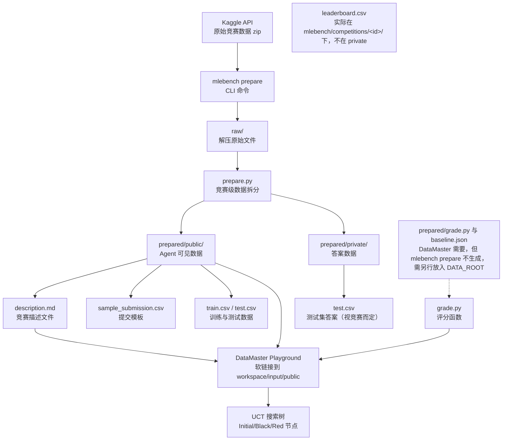
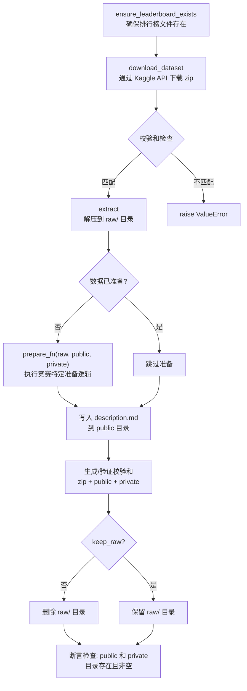

MLE-Bench 是由 OpenAI 发布的机器学习工程评测基准，包含 75 个 Kaggle 竞赛任务，用于评估 AI 智能体（agent，能自己写代码、跑代码、根据结果再决定下一步的程序）的 ML 工程能力。DataMaster 框架以此为底层数据源，通过数据准备流水线、任务配置（设计上由脚本自动生成，但该脚本当前有缺陷，见下文）和初始代码模板注入，将原始 Kaggle 竞赛转化为可供 UCT 搜索树消费的结构化任务输入。本文将面向初学者，系统讲解从 MLE-Bench 数据集下载到 DataMaster 任务输入就绪的完整流程。

> **📖 小白导读**
> - 这篇讲什么：比赛数据从哪来、长什么样、怎么被拆成“给 agent 看的”和“藏起来打分用的”两份，以及 DataMaster 怎么把它接到自己的工作目录里。
> - 读之前先知道：**Kaggle**（机器学习竞赛平台）、**训练集/测试集**（前者给模型学习，后者用来考试）、**CSV**（逗号分隔的表格文本）、**软链接 symlink**（指向别处文件的“快捷方式”）、**checksum 校验和**（文件的指纹，用来确认下载内容没变）。
> - 读完你能明白：`prepared/public` 与 `prepared/private` 的区别；`grade.py`、`baseline.json` 为什么需要而 `mlebench prepare` 并不生成；`--initial-code` 到底吃什么。
> - 提醒：原文把 `initial_code.json` 描述成可被 `--initial-code` 直接使用，这是错的，已改正。

## MLE-Bench 数据集整体架构

MLE-Bench 的核心设计理念是将在线 Kaggle 竞赛转换为离线可复现的评测任务。由于 Kaggle 不提供原始测试集标签，MLE-Bench 为每个竞赛提供独立的 `prepare.py` 脚本，将公开训练集重新拆分为新的训练集和测试集，并配套评分脚本用于自动评判。

以下 Mermaid 图展示了从 Kaggle 原始数据到 DataMaster 可消费任务输入的完整数据流：



整个数据集以竞赛 ID 为基本组织单元，每个竞赛在仓库中有独立的配置目录，在本地缓存中有独立的数据目录。**重要差异**：MLE-Bench 原生的 `prepare` 只会产出 `prepared/public/`、`prepared/private/`（以及 `raw/`、校验和等），代码里没有任何地方生成 `prepared/grade.py` 或 `prepared/baseline.json`；而 DataMaster 的 `_ensure_prepared_links` 与评分回退逻辑都依赖这两个文件（playground.py:391-397、_submission_utils.py:1261）。它们从哪里来，仓库中找不到（未验证；推断需要使用者在 `DATA_ROOT` 里自行补上）。

Sources: [README.md](mle-bench/README.md#L125-L158), [data.py](mle-bench/mlebench/data.py#L37-L151)

## 竞赛注册表：Competition 数据模型

MLE-Bench 使用一个 **Registry（注册表）** 模式来管理所有竞赛的元数据。`Competition` 是一个 frozen dataclass（创建后字段不可修改的数据类），封装了单个竞赛所需的全部信息。

### Competition 数据类字段说明

| 字段 | 类型 | 说明 |
|------|------|------|
| `id` | `str` | 竞赛唯一标识符，如 `spaceship-titanic` |
| `name` | `str` | 竞赛显示名称 |
| `description` | `str` | 竞赛描述全文（从 `description.md` 读取） |
| `grader` | `Grader` | 评分器，包含评分函数和奖牌判定逻辑 |
| `answers` | `Path` | 测试集答案文件路径 |
| `gold_submission` | `Path` | 黄金提交文件路径（默认同 answers） |
| `sample_submission` | `Path` | 样例提交文件路径 |
| `competition_type` | `str` | 竞赛类型（如 `simple`、`code`） |
| `prepare_fn` | `Callable` | 数据准备函数，签名为 `(raw, public, private)` |
| `raw_dir` | `Path` | 原始数据解压目录 |
| `private_dir` | `Path` | 私有数据目录（答案、评分数据） |
| `public_dir` | `Path` | 公开数据目录（Agent 可见数据） |
| `checksums` | `Path` | 校验和文件路径 |
| `leaderboard` | `Path` | 排行榜文件路径 |

Registry 通过 `rglob("config.yaml")` 扫描 `mlebench/competitions/` 目录下的所有 `config.yaml` 文件来列出可用竞赛（registry.py:146-152）；按 id 取单个竞赛时则直接读 `competitions/<id>/config.yaml`。每个竞赛的配置文件定义了数据路径、评分器和准备器的模块引用。

Sources: [registry.py](mle-bench/mlebench/registry.py#L16-L116), [config.yaml](mle-bench/mlebench/competitions/spaceship-titanic/config.yaml#L1-L17)

### 竞赛配置文件结构

每个竞赛目录下包含标准化的文件集合，以 `spaceship-titanic` 为例：

```
mlebench/competitions/spaceship-titanic/
├── config.yaml            # 竞赛元数据配置
├── description.md         # 竞赛描述（Agent 可读）
├── description_obfuscated.md  # 混淆版描述（防泄露）
├── prepare.py             # 数据准备脚本
├── grade.py               # 评分脚本
├── checksums.yaml         # 文件校验和
├── leaderboard.csv        # Kaggle 排行榜数据
└── kernels.txt            # 参考内核列表
```

`config.yaml` 中的 `dataset` 字段定义了答案和样例提交的相对路径，`grader` 字段通过 `模块路径:函数名` 的格式引用评分函数，`preparer` 字段以同样方式引用数据准备函数。这种基于模块路径的动态导入设计使得评分逻辑和数据准备逻辑可以按竞赛独立定制。

Sources: [registry.py](mle-bench/mlebench/registry.py#L78-L116), [config.yaml](mle-bench/mlebench/competitions/spaceship-titanic/config.yaml#L1-L17)

## 数据准备流水线：从 Kaggle 下载到 train/test 拆分

### CLI 入口与命令参数

MLE-Bench 提供统一的 CLI 工具 `mlebench` 进行数据准备，支持按竞赛 ID、Lite 子集或全量列表三种模式下载和准备数据。

| 命令 | 用途 | 示例 |
|------|------|------|
| `mlebench prepare -c <id>` | 准备单个竞赛 | `mlebench prepare -c spaceship-titanic` |
| `mlebench prepare --lite` | 准备 Lite 子集（22 个低复杂度竞赛） | `mlebench prepare --lite` |
| `mlebench prepare --all` | 准备全部 75 个竞赛 | `mlebench prepare --all` |
| `mlebench prepare -l <file>` | 按文本文件列表准备 | `mlebench prepare -l split75.txt` |

关键可选参数包括 `--keep-raw`（保留原始解压文件）、`--data-dir`（自定义数据存储目录）、`--skip-verification`（跳过校验和验证）等。默认数据存储在系统缓存目录下的 `mle-bench/data/` 路径（`DEFAULT_DATA_DIR = user_cache_dir()/mle-bench/data`，registry.py:13）。注意：Python 函数 `download_and_prepare_dataset` 的 `keep_raw` 默认是 `True`，但命令行 `--keep-raw` 的默认是 `False`，所以用命令行准备数据时默认会删除 `raw/`。

Sources: [cli.py](mle-bench/mlebench/cli.py#L17-L82), [README.md](mle-bench/README.md#L136-L158)

### 数据准备核心流程

`download_and_prepare_dataset` 函数是整个数据准备的核心，执行以下步骤：



Kaggle API 认证需要在 `~/.kaggle/` 目录放置 `kaggle.json` 凭证文件。下载过程用 `tenacity` 的 `@retry` 装饰器内置了重试机制，遇到 Kaggle API 异常时最多尝试 3 次，间隔 5 秒（data.py:196-201）。如果竞赛需要先接受规则，会提示用户在浏览器中打开竞赛规则页面。

Sources: [data.py](mle-bench/mlebench/data.py#L37-L151), [utils.py](mle-bench/mlebench/utils.py#L25-L41)

### 竞赛级 prepare 函数：train/test 拆分

每个竞赛的 `prepare.py` 文件实现一个 `prepare(raw, public, private)` 函数，负责将原始数据拆分为 Agent 可见的公开数据和用于评分的私有数据。以 `spaceship-titanic` 为例（`prepare` 函数的三个参数 `raw`、`public`、`private` 分别是原始数据、给 agent 看的目录、藏答案的目录）：

该函数从 `raw/train.csv` 读取原始训练数据，使用 `sklearn.model_selection.train_test_split` 以 `test_size=0.1` 和 `random_state=0` 拆分为新训练集和测试集。新训练集写入 `public/train.csv`，测试集去除目标列后写入 `public/test.csv`（供 Agent 预测），带目标列的完整测试集写入 `private/test.csv`（供评分使用）。同时生成一个全 `False` 的 `sample_submission.csv` 作为提交格式模板。

对于涉及图像数据的竞赛（如 `aerial-cactus-identification`），prepare 函数还负责图像文件的拆分与压缩：从原始 `train.zip` 中解压图像，按拆分结果分别复制到 `public/train.zip` 和 `public/test.zip`，并在末尾执行多维度断言检查（训练/测试 ID 不重叠、列名一致、数据量守恒等）。

Sources: [prepare.py](mle-bench/mlebench/competitions/spaceship-titanic/prepare.py#L8-L23), [prepare.py](mle-bench/mlebench/competitions/aerial-cactus-identification/prepare.py#L10-L72)

### 数据完整性验证

MLE-Bench 通过 **MD5 校验和**（把文件内容压缩成一串固定长度的“指纹”，内容变了指纹就变）机制保证数据准备的完整性和可复现性。`checksums.yaml` 文件存储三层校验和：`zip`（原始压缩包）、`public`（公开目录下的文件，原文称仅含 csv/json/jsonl/parquet/bson，该过滤规则未逐行核对）和 `private`（私有目录下的对应文件）。

```yaml
# spaceship-titanic/checksums.yaml 示例
private:
  test.csv: 1cb99c65efecaba968128577722a83ef
public:
  sample_submission.csv: 5414b5da6ebcff454de1c9ed39b73774
  test.csv: 8186bd4048aece25f1ed45708f8f34e1
  train.csv: 564a1614ecef9d9611cec4efdce4c412
zip: 67c177886736583aff9b947e121395a9
```

在准备完成后，系统会重新计算所有文件的校验和并与已存储的预期值比对，不匹配则抛出包含 diff 信息的 `ValueError`。开发者可通过 `--overwrite-checksums` 参数强制覆盖校验和文件（普通使用者不需要）。

Sources: [data.py](mle-bench/mlebench/data.py#L112-L141), [checksums.yaml](mle-bench/mlebench/competitions/spaceship-titanic/checksums.yaml#L1-L8)

## 任务拆分：75 个竞赛的复杂度分级

MLE-Bench 将 75 个竞赛按复杂度分为 Low、Medium、High 三级，分别存储在 `experiments/splits/` 目录下的文本文件中，每行一个竞赛 ID。

| 拆分文件 | 竞赛数量 | 说明 | 典型竞赛 |
|----------|----------|------|----------|
| `low.txt` | 22 | 低复杂度，即 Lite 版本 | `spaceship-titanic`、`aerial-cactus-identification` |
| `medium.txt` | 38 | 中等复杂度 | `AI4Code`、`cassava-leaf-disease-classification` |
| `high.txt` | 15 | 高复杂度 | `3d-object-detection-for-autonomous-vehicles`、`bms-molecular-translation` |
| `split75.txt` | 75 | 全量竞赛集合 | 所有上述竞赛的并集 |
| `dev.txt` | 7 | 开发调试用 | `spaceship-titanic`、`paddy-disease-classification` |

Lite 子集（`low.txt`）是推荐的轻量评测入口，总数据量约 158GB，而完整 75 个竞赛的数据量高达 3.3TB（均来自 mle-bench/README.md:72）。Registry 的 `get_lite_competition_ids()` 方法直接读取 `low.txt` 来获取 Lite 竞赛列表。

Sources: [registry.py](mle-bench/mlebench/registry.py#L128-L134), [low.txt](mle-bench/experiments/splits/low.txt#L1-L22), [README.md](mle-bench/README.md#L68-L99)

## DataMaster 对 MLE-Bench 数据的集成

### 数据目录映射与软链接

DataMaster 的 `DataTreePlayground` 在 `setup()` 末尾通过 `_ensure_prepared_links` 方法建立数据访问桥梁（playground.py:296-298）。该方法从配置中读取 `exp_id`（竞赛 ID）和 `data_root`（数据根目录），拼接出 `{data_root}/{exp_id}/prepared/` 路径，然后创建以下软链接到工作空间：

| 源路径 | 目标路径 | 用途 |
|--------|----------|------|
| `prepared/baseline.json` | `workspace/baseline.json` | 基线配置 |
| `prepared/grade.py` | `workspace/grade.py` | 评分脚本 |
| `prepared/public/` | `workspace/input/public/` | Agent 可见的公开数据 |

软链接创建采用带重试的安全机制（`_safe_symlink`），最多重试 3 次，处理并发竞态条件（race condition：多个线程同时操作同一路径导致的偶发冲突）下的 `FileExistsError` 和 `OSError`。如果已存在有效软链接则跳过，断开的链接会被清除重建。**任何一个源文件不存在（例如 `baseline.json`、`grade.py`）都只会打 warning 并继续**，不会报错中止，所以缺文件时问题会推迟到评分阶段才暴露。另外要注意：初始代码模板（如 aerial-cactus 的 `data_loader.py`）里读的是 `./input/train.csv`，而这里软链接的位置是 `input/public/`，两者路径并不一致（agent 在节点里会自行改写代码；实际如何对齐未验证）。

Sources: [playground.py](playground/data_master/core/playground.py#L314-L407), [config_base.yaml](configs/data_master/config_base.yaml#L6-L7)

### 配置自动生成：auto_config_exp.py

DataMaster 提供了 `scripts/auto_config_exp.py` 脚本来自动为每个竞赛生成所需的配置文件。该脚本从三个基础模板（`base_initial.json`、`base_all.json`、`base_datanode.json`）和 YAML 模板（`config_base.yaml`）出发，通过替换占位符生成竞赛级配置。**但目前它有已知缺陷**：用 `string.Template.substitute` 渲染 YAML，而没有传 `use_red_node`、`use_memory`，`config_base.yaml` 第 285-286 行有这两个占位符，会抛 KeyError；`black_mode` 不在模板里；脚本末尾要更新的 `run_mle.sh` 仓库里不存在；仓库里现有的 75 份 YAML 是旧模板生成的，不含 `ablation` 段（读代码得出，未实测）。

每个竞赛最终生成三类 MCP JSON 配置和一个 YAML 配置：

| 配置文件 | 模板 | 包含的 MCP 服务 | 用途 |
|----------|------|-----------------|------|
| `initial_{id}.json` | `base_initial.json` | `operate_submission_for_initial` + `memory_tree` | Initial 节点工具集 |
| `node_all_{id}.json` | `base_all.json` | 上述 + `operate_submission` + 4 个搜索工具 | 全功能节点工具集 |
| `data_node_{id}.json` | `base_datanode.json` | `operate_submission` + `memory_tree` + 4 个搜索工具 | Black/Red 节点工具集 |
| `config_{id}.yaml` | `config_base.yaml` | — | 主配置文件 |

配置生成过程中，脚本据称会将模板中的 `${DATA_ROOT}` 替换为实际数据根目录（但仓库里现成的 `node_all_...json` 中仍保留着字面量 `"${DATA_ROOT}"`），将 `ML_MASTER_DATA_EXPID` 替换为竞赛 ID，将 `ML_MASTER_GRADING_SERVERS` 替换为评测服务器地址。对于带后缀的变体实验（如 `_effnetb3`、`_v1`），脚本会正确去除后缀来获取基础竞赛名，确保数据路径指向正确的竞赛数据。

Sources: [auto_config_exp.py](scripts/auto_config_exp.py#L55-L168), [base_initial.json](configs/data_master/base_initial.json#L1-L26)

### MCP 配置中的环境变量约定

所有 MCP 配置中的环境变量遵循统一命名约定，这些变量在运行时被 `operate_submission` 工具读取来定位数据和评测服务：

| 环境变量 | 说明 | 示例值 |
|----------|------|--------|
| `ML_MASTER_DATA_ROOT` | 数据根目录，对应 `mlebench prepare --data-dir` | `/data/mle-bench/data` |
| `ML_MASTER_DATA_EXPID` | 竞赛 ID，用于定位 `{data_root}/{exp_id}/prepared/` | `aerial-cactus-identification` |
| `ML_MASTER_GRADING_SERVERS` | 评测服务器 URL | `http://127.0.0.1:55918` |

DataTreePlayground 在 `setup()` 中也会将 `ML_MASTER_DATA_EXPID`、`ML_MASTER_DATA_ROOT` 写入 `os.environ`（`ML_MASTER_GRADING_SERVERS` 则在 `_ensure_grading_server_ready` 里写入），供本进程及其子进程继承。注意：MCP 的 JSON 配置不做 `${VAR}` 展开（只有主 YAML 展开），所以 JSON 里的 `"${DATA_ROOT}"` 会以字面量形式传给 MCP 子进程；最终子进程看到的是哪个值，取决于 mcp 库如何合并环境变量（未验证）。

Sources: [playground.py](playground/data_master/core/playground.py#L289-L294), [node_all.json](configs/data_master/json_configs/aerial-cactus-identification/node_all_aerial-cactus-identification.json#L1-L75)

## 初始代码模板：data_loader_format 体系

### 三文件结构

DataMaster 为每个竞赛提供标准化的初始代码模板，存放在 `initial_code/data_loader_format/{competition_id}/` 目录下，采用三文件分离结构：

| 文件 | 职责 | 说明 |
|------|------|------|
| `data_loader.py` | 数据加载与预处理 | 定义 `MyDataLoader(BaseDataLoader)` 类，封装数据读取、特征工程、数据增强、训练/验证集划分 |
| `algo.py` | 模型训练与预测 | 包含模型定义、训练循环、早停机制、TTA（测试时增强）和提交文件生成 |
| `full_code.py` | 上述两者的拼接 | 由 `build_full_initial_codes.py` 脚本自动生成，`data_loader.py` + `\n\n` + `algo.py` |

`data_loader.py` 中的 `MyDataLoader` 类遵循统一接口约定：`__init__` 接收超参数（batch_size、img_size、num_workers、seed 等），`setup()` 方法执行数据加载和预处理并设置 `self.train_data` 和 `self.test_data`，`describe()` 方法返回数据处理方案的文字描述。该类还支持通过 `val.csv` 文件指定固定验证集，实现可复现的验证流程。

Sources: [data_loader.py](initial_code/data_loader_format/aerial-cactus-identification/data_loader.py#L1-L209), [algo.py](initial_code/data_loader_format/aerial-cactus-identification/algo.py#L1-L174), [build_full_initial_codes.py](scripts/build_full_initial_codes.py#L14-L59)

### initial_code.json：内联代码字典

除了文件形式的初始代码，DataMaster 还维护了一个 `playground/data_master/initial_code.json` 文件，将 75 个竞赛的完整初始代码以 JSON 字典形式内联存储，键为竞赛 ID，值为完整的 Python 代码字符串。**原文称“该文件使得 DataMaster 可以通过 `--initial-code` 快速注入初始代码”，这没有代码依据**：在 `.py/.sh/.md` 文件中搜不到任何引用 `initial_code.json` 的地方（未验证是否有外部脚本使用），并且文件内个别竞赛（如 `imet-2020-fgvc7`、`tensorflow2-question-answering`）的值是 null。

`--initial-code` 实际吃的是**一个文件路径**：`run.py` 检查文件存在后 `open().read()` 读出全部文本（run.py:490-498），再传给 `DataTreePlayground.set_initial_config()`，Initial 节点执行时把它作为起始代码使用；二者都没给时进入自由模式（run.py:507）。要用现成模板，应传 `initial_code/data_loader_format/<id>/full_code.py`。

Sources: [initial_code.json](playground/data_master/initial_code.json#L1-L50), [run.py](run.py#L82-L90), [playground.py](playground/data_master/core/playground.py#L92-L101)

## 评测服务：Grading Server 集成

### DataMaster 内嵌评测服务器

与 MLE-Bench 原生的 Docker 容器内评测服务器不同，DataMaster 采用本地内嵌方式运行评测服务器。`DataTreePlayground._start_grading_server_process()` 方法从配置中读取唯一的 grading server URL，设计上启动 `grading_server_runner.py` 作为子进程；**但该方法拼出的 runner 路径少了 `playground/` 一层**（`project_root/search_dataset_tools/operate_submission/grading_server_runner.py`，而真实位置在 `playground/search_dataset_tools/...`），文件不存在，会抛 RuntimeError（playground.py:195-201）。此外仓库还有一个嵌入式版本 `playground/data_master/core/utils/grading_server.py`，由 `grading.py::validate_submission` 在节点结算时拉起（未逐行验证）。

评测服务器基于 Flask（一个轻量的 Python 网站框架）实现，提供两个核心端点：

| 端点 | 方法 | 功能 |
|------|------|------|
| `/validate` | POST | 接收提交 CSV 文件和 `exp-id` 请求头，调用 `mlebench.grade.validate_submission` 验证提交格式（只检查格式，不给分数；文件临时存为写死的 `/tmp/submission_to_validate.csv`） |
| `/health` | GET | 返回 `{"status": "running"}`，用于健康检查 |

服务器启动后会在 20 秒内等待健康检查通过，超时则抛出异常。`run()` 开头和每个节点开头都会调用 `_ensure_grading_server_ready()`，发现服务器不健康时尝试在同一端口重启（playground.py:871、1141）——不过重启走的还是上面那条路径错误的启动函数，所以建议事先手动启动评分服务（见评分服务器一页）。

Sources: [grading_server_runner.py](playground/search_dataset_tools/operate_submission/grading_server_runner.py#L17-L43), [playground.py](playground/data_master/core/playground.py#L181-L276), [_submission_utils.py](playground/search_dataset_tools/operate_submission/_submission_utils.py#L374-L399)

### 评分与奖牌判定

MLE-Bench 的评分体系不仅计算原始分数，还将其映射到 Kaggle 奖牌体系。`Grader` 类的 `rank_score` 方法根据竞赛排行榜的参赛队伍数和分数分布，计算金/银/铜牌和中位数阈值。奖牌阈值遵循 Kaggle 官方进度规则：

| 参赛队伍数 | 金牌阈值 | 银牌阈值 | 铜牌阈值 |
|------------|----------|----------|----------|
| 1–99 | 前 10% | 前 20% | 前 40% |
| 100–249 | 前 10 名 | 前 20% | 前 40% |
| 250–999 | 前 (10 + 0.2%) 名 | 前 50 名 | 前 100 名 |
| ≥1000 | 前 (10 + 0.2%) 名 | 前 5% | 前 10% |

这套奖牌判定属于 MLE-Bench 原生评测；DataMaster 搜索过程中是否使用它未验证。`Grader.is_lower_better` 方法通过比较排行榜首尾分数来判断"越低越好"还是"越高越好"，自动适配不同类型的评估指标（如 RMSE 越低越好，AUC 越高越好）。

Sources: [grade_helpers.py](mle-bench/mlebench/grade_helpers.py#L21-L159), [grade.py](mle-bench/mlebench/grade.py#L52-L95)

## 任务输入组装：从竞赛描述到 Agent 提示词

### 任务描述文件

MLE-Bench 为每个竞赛提供 `description.md` 文件，包含竞赛背景、评估指标、提交格式和数据字段说明。在数据准备完成后，该文件会被复制到 `prepared/public/description.md`，Agent 通过 `/home/data/description.md` 路径读取（MLE-Bench 原生 Docker 模式，见 instructions.txt）；DataMaster 本地模式下，`--task` 通常直接指向 `$DATA_ROOT/<id>/prepared/public/description.md`，其内容作为任务描述传入。

`instructions.txt` 文件定义了 MLE-Bench 的通用基准指令，核心约定包括：所有竞赛统一使用 CSV 提交格式，提交文件必须位于 `/home/submission/submission.csv`，数据集位于 `/home/data/`，以及禁止查看他人方案的反作弊规则。这是 MLE-Bench 原生容器里的约定；DataMaster 本地模式的提交路径由它自己的 prompt 与工具决定，默认共用固定名 `submission/submission.csv`（见并行执行一页）。

Sources: [instructions.txt](mle-bench/environment/instructions.txt#L1-L19), [data.py](mle-bench/mlebench/data.py#L109-L110)

### Metric 方向判定

DataMaster 在评估反馈闭环中需要知道当前竞赛的评估指标方向（越大越好还是越小越好）。`scripts/get_metric_direction.py` 脚本从运行目录的 `config.yaml` 中提取 `exp_id`，然后从 `result.csv` 文件中查找对应竞赛的 metric 方向（`lower` 或 `higher`）。该脚本默认的 `result.csv` 路径是字面量 `"${PROJECT_ROOT}/result.csv"`（脚本不会展开它），而仓库里并没有 `result.csv`，所以通常需要自己传第二个参数并自备该文件；脚本本身也未发现被主流程调用（未验证）。

在 `run.py` 中，用户也可以通过 `--force-minimize` 或 `--force-maximize` 参数手动指定指标方向，这在 `--test-feedback` 模式下是必需的。

Sources: [get_metric_direction.py](scripts/get_metric_direction.py#L32-L50), [run.py](run.py#L93-L109)

## 端到端工作流总结

将以上所有组件串联起来，一个典型的 DataMaster 任务输入准备流程如下：


**第一步**：通过 `mlebench prepare -c <competition_id>` 下载 Kaggle 数据并执行 `prepare.py` 拆分，生成 `prepared/public/` 和 `prepared/private/` 目录。

**第二步**：运行 `auto_config_exp.py` 生成该竞赛的 MCP JSON 配置（initial/node_all/data_node）和 YAML 主配置，设置正确的 `ML_MASTER_DATA_ROOT`、`ML_MASTER_DATA_EXPID` 和 `ML_MASTER_GRADING_SERVERS` 环境变量。

**第三步**：`run()` 开头调用 `_ensure_grading_server_ready()` 检查评分服务，不健康时会尝试拉起，但这条自动拉起路径目前有路径错误；建议你先手动启动并确认 `/health` 可访问。

**第四步**：通过 `run.py --agent data_master --config <yaml> --task <description.md>` 启动搜索。

**第五步**：`_ensure_prepared_links` 创建从 `prepared/public/` 到 `workspace/input/public/` 的软链接，使 Agent 可以访问训练数据和样例提交。

**第六步**：Initial 节点接收竞赛描述和初始代码模板（通过 `--initial-code <文件路径>`；`initial_code.json` 没有被代码引用），生成首个可执行的 ML 方案。

**第七步**：UCT 搜索树通过 Black 节点（数据增强）和 Red 节点（外部数据搜索）迭代优化，每次提交通过 grading server 的 `/validate` 端点验证格式正确性，节点的得分来自 metric agent 对运行输出的解析（见评估反馈一页），`grade.py` 主要用于对 submission 单独打分（具体调用点未逐一核对）。

Sources: [cli.py](mle-bench/mlebench/cli.py#L158-L191), [auto_config_exp.py](scripts/auto_config_exp.py#L69-L168), [playground.py](playground/data_master/core/playground.py#L279-L300), [run.py](run.py#L213-L285)

## 下一步阅读

完成数据集与任务输入准备后，建议按以下顺序继续深入：

- [仓库目录结构与模块职责速览](5-cang-ku-mu-lu-jie-gou-yu-mo-kuai-zhi-ze-su-lan)：了解整体代码组织，理解各模块间的依赖关系。
- [DataTree 搜索流程全解析：从初始化到并行搜索](7-datatree-sou-suo-liu-cheng-quan-jie-xi-cong-chu-shi-hua-dao-bing-xing-sou-suo)：深入理解 UCT 搜索树如何消费任务输入并驱动节点扩展。
- [评估反馈闭环：Metric Agent 与验证指标解析](11-ping-gu-fan-kui-bi-huan-metric-agent-yu-yan-zheng-zhi-biao-jie-xi)：了解评分结果如何反馈到搜索决策中。
- [Grading Server：评测服务器部署、健康检查与 API 接口](24-grading-server-ping-ce-fu-wu-qi-bu-shu-jian-kang-jian-cha-yu-api-jie-kou)：掌握评测服务器的部署细节和接口规范。
- [MLE-Bench 集成与 75 个任务的配置定制](28-mle-bench-ji-cheng-yu-75-ge-ren-wu-de-pei-zhi-ding-zhi)：了解 75 个竞赛的配置定制策略和变体实验设计。

## 本文修订记录
- 原文称 `initial_code.json` 能配合 `--initial-code` 注入；仓库无任何代码引用该文件，`--initial-code` 实际吃文件路径（run.py:490-498）。已改正。
- 原文流程图把 `grade.py`、`leaderboard.csv` 画成 `mlebench prepare` 的产物；实际 prepare 只产出 public/private（data.py:37-151），`grade.py`/`baseline.json` 需另行提供，leaderboard 在 competitions 目录。已修改图并加说明（来源未验证）。
- 原文称 grading server 在 `setup()` 内启动；实际在 `run()` 开头及每个节点前经 `_ensure_grading_server_ready()` 触发，且拉起路径缺 `playground/` 一层（playground.py:195-201、1141）。已改正。
- 补充 `auto_config_exp.py` 的已知缺陷（缺 `use_red_node`/`use_memory` 必抛 KeyError 等）、MCP JSON 不展开 `${VAR}`、`get_metric_direction.py` 的 `result.csv` 默认路径是字面量。
- 补充 `--keep-raw` 命令行默认与函数默认不同、重试装饰器位置、`_safe_symlink` 缺文件只警告、`/validate` 只校验格式。
- 未验证：checksum 过滤的文件类型、prepared/grade.py 的来源、模板里 `./input` 与 `input/public` 的对齐方式。
- 新增小白导读及 Kaggle、CSV、symlink、checksum、Flask 等术语解释。
