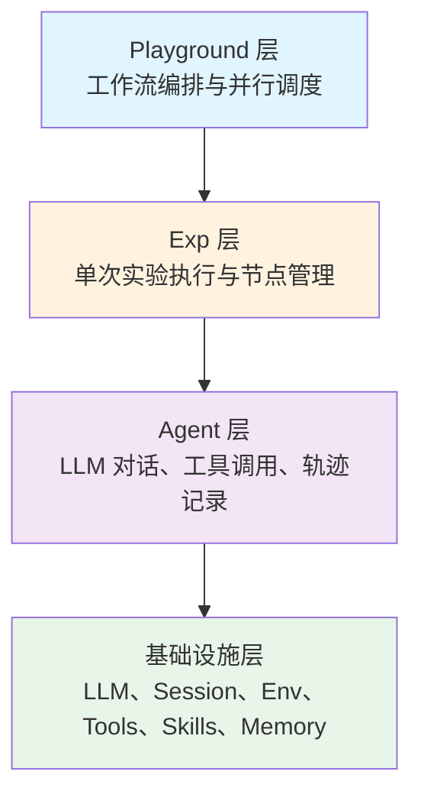
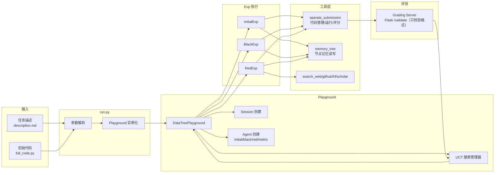

DataMaster 仓库是一个以 **数据侧优化**为核心的自主机器学习实验框架。整个仓库围绕 **DataTree 搜索**这一核心范式展开，通过 UCT 算法驱动红节点（外部数据探索）和黑节点（数据精炼）的迭代搜索，最终在 MLE-Bench 任务上找到最优数据流水线。本文将自顶向下地梳理仓库的完整目录结构，为每一层模块标注其核心职责，帮助初学者在进入源码阅读前建立全局认知。

> **📖 小白导读**
> - 这篇讲什么：把整个仓库当成一张“地图”，告诉你每个文件夹里放的是什么、谁依赖谁。
> - 读之前先知道：**目录/模块**（文件夹与 Python 文件）、**Playground / Exp / Agent**（本项目的三层结构：工作流总指挥、单次实验、会调用 LLM 的智能体，详见第 6 篇）、**MCP**（让 agent 调用外部工具服务的协议）、**Flask**（用 Python 写小型网站服务的库）。
> - 读完你能明白：想改某个功能时该进哪个目录；`evomaster`（通用地基）和 `playground`（具体业务）的分工；`ml_master` 与 `data_master` 为什么长得像但相互独立。
> - 提醒：原文几处数字（MCP 服务器数、skills 个数、行数）和“共享组件”一栏与代码不符，已更正。

Sources: [README.md](README.md#L25-L29), [README_CN.md](README_CN.md#L77-L97)

## 顶层目录全景

仓库根目录包含 **7 个核心子目录**（configs、docs、evomaster、initial_code、mle-bench、playground、scripts）和若干顶层文件（`run.py`、`pyproject.toml`、`requirements.txt`、`LICENSE`，另有 `README.md`、`README_CN.md`），各自承担明确的工程角色：

```text
DataMaster/
├── run.py              # 命令行入口，解析参数并启动 Playground
├── pyproject.toml      # 项目元数据与依赖声明（共 551 行，其中 dependencies 约 520 行）
├── requirements.txt    # pip 依赖快照（516 行，是否与 pyproject.toml 完全同步未逐项核对）
├── configs/            # 配置体系：YAML 主配置 + JSON MCP 工具配置
├── docs/               # 中英文文档（architecture.md, agent.md 等）
├── evomaster/          # 核心库：Agent、Exp、Playground、Env、Skills、Memory
├── initial_code/       # 22 个任务的初始代码模板（data_loader_format 格式）
├── mle-bench/          # MLE-Bench 基准评测集成与评测服务器
├── playground/         # 具体工作流实现（data_master、ml_master、search_dataset_tools）
├── scripts/            # 运维辅助脚本（配置生成、端口诊断、可视化）
└── LICENSE             # Apache 2.0 开源协议
```

顶层 `run.py` 是唯一的用户入口。它通过 `argparse` 解析 `--agent`、`--config`、`--task` 等参数后，调用 `auto_import_playgrounds()` 自动导入 `playground/` 下所有子目录的 `core/playground.py` 模块，触发 `@register_playground` 装饰器注册，再通过 `get_playground_class()` 获取对应的 Playground 实例并运行任务。

Sources: [run.py](run.py#L1-L8), [run.py](run.py#L399-L436), [LICENSE](LICENSE#L1-L2)

## 架构分层总览

DataMaster 采用 **三层架构**，这一架构贯穿了从核心库到具体工作流的全部代码组织：



三层之间的调用关系是严格的自顶向下：Playground 负责创建和配置多个 Agent 实例，将它们分配给不同的 Exp；Exp 在执行过程中调用 Agent 的 `run()` 方法，Agent 内部通过 LLM 接口发起查询、通过 Session 执行命令、通过 Tools 注册表调用工具。（LLM = 大语言模型；Session = “会话”，负责真正在本机或 Docker 容器里执行命令；tool = agent 可以调用的函数，如执行 bash、改文件。）

Sources: [docs/architecture.md](docs/architecture.md#L26-L45)

## evomaster/ — 核心库

`evomaster/` 是框架的引擎室，提供了所有基础抽象和通用组件。它不包含任何特定于 DataMaster 工作流的业务逻辑，而是作为 **可复用的 Agent 框架**供上层 Playground 继承和扩展。

### 目录结构

```text
evomaster/
├── config.py            # 配置管理：环境变量替换、Pydantic 校验
├── core/                # 三层架构基类
│   ├── exp.py           # BaseExp：单次实验基类
│   ├── playground.py     # BasePlayground：工作流基类（约 1462 行）
│   └── registry.py      # Playground 注册器：@register_playground 装饰器
├── agent/               # Agent 子系统
│   ├── agent.py         # BaseAgent：对话管理、工具调用、轨迹记录
│   ├── context.py       # ContextManager：上下文截断策略
│   ├── session/         # 会话管理：LocalSession / DockerSession
│   └── tools/           # 工具体系：builtin / mcp / skill
├── env/                 # 执行环境：LocalEnv / DockerEnv（bohrium.py 实为认证/MCP 计算存储配置而非 Env 类；k8s/ 下只有一个 run-mle.yaml 示例文件）
├── memory/              # 记忆系统：SQLite + FTS5 全文检索
├── skills/              # 技能系统：10 个技能包目录（三级结构；DataMaster 的 agent 配置没有 `skills:` 键，实际未使用）
├── monitoring/          # 告警系统：飞书通知集成
├── interface/           # 外部接口：飞书消息分发
├── skills_ts/           # TypeScript 桥接：飞书文档/Drive/Wiki 插件
└── utils/              # 通用工具：LLM 抽象层、类型定义、日志格式化
```

### 核心模块职责速查

| 模块 | 核心类/文件 | 职责 |
|------|------------|------|
| `core/registry.py` | `@register_playground` | 装饰器注册机制，将 Playground 类名映射到 agent 名称 |
| `core/playground.py` | `BasePlayground` | 配置加载、Agent 初始化、Session 生命周期管理、并行执行调度、MCP 连接管理 |
| `core/exp.py` | `BaseExp` | 接收任务描述、创建 TaskInstance、运行 Agent、收集 Trajectory |
| `agent/agent.py` | `BaseAgent`/`Agent` | 对话循环（`max_turns` 控制）、工具执行、上下文截断、轨迹序列化 |
| `agent/context.py` | `ContextManager` | 上下文窗口溢出时的截断策略（`latest_half` 等） |
| `agent/session/` | `LocalSession`/`DockerSession` | 命令执行环境，本地直连或 Docker 隔离 |
| `agent/tools/builtin/` | `bash.py`/`editor.py`/`think.py`/`finish.py` | 四个内置工具：Bash 命令、文件编辑、思考工具、完成信号 |
| `agent/tools/mcp/` | `MCPToolManager` | MCP 协议工具集成，连接外部 MCP 服务器 |
| `env/local.py` | `LocalEnv` | 本地执行环境，包含 GPU/CPU 资源分配器 |
| `env/docker.py` | `DockerEnv` | Docker 容器化执行环境，通过 PS1 标记解析输出（PS1 是 shell 的命令提示符，这里被用作“命令结束”的记号） |
| `memory/` | `MemoryStore`/`MemoryManager` | SQLite + jieba FTS5（全文检索）存储（store.py 文件头注释）；“自动捕获用户偏好和事实”未验证。注意这是 evomaster 通用记忆，**与 DataMaster 的 Memory Tree 是两套东西** |
| `skills/base.py` | `BaseSkill`/`SkillRegistry` | 三级技能结构：meta_info（~100 token，token 是 LLM 计费/计长的最小文字单位）、full_info、scripts |
| `utils/llm.py` | `BaseLLM` | 多供应商 LLM 抽象层，支持 OpenAI/Anthropic 等 |

Sources: [evomaster/core/registry.py](evomaster/core/registry.py#L1-L15), [evomaster/core/playground.py](evomaster/core/playground.py#L128-L141), [evomaster/core/exp.py](evomaster/core/exp.py#L97-L115), [evomaster/agent/agent.py](evomaster/agent/agent.py#L1-L30), [evomaster/agent/README.md](evomaster/agent/README.md#L1-L32), [evomaster/env/README.md](evomaster/env/README.md#L1-L8), [evomaster/skills/__init__.py](evomaster/skills/__init__.py#L1-L12), [evomaster/memory/store.py](evomaster/memory/store.py#L1-L5), [evomaster/utils/llm.py](evomaster/utils/llm.py#L1-L4)

## playground/ — 工作流实现

`playground/` 目录是 **具体业务工作流**的落地区。每个子目录代表一个注册到 `run.py` 的独立 Playground，通过 `@register_playground("name")` 装饰器与命令行 `--agent` 参数对应。

### 目录结构与职责

```text
playground/
├── data_master/            # [主工作流] DataTree 搜索：Initial → Black → Red
│   ├── core/
│   │   ├── playground.py   # DataTreePlayground（1221 行，注册为 "data_master"）
│   │   ├── exp/            # 四类节点实验
│   │   │   ├── initial_exp.py   # InitialExp：根节点初始代码生成
│   │   │   ├── black_exp.py     # BlackExp：数据增强与特征工程
│   │   │   ├── red_exp.py       # RedExp：外部数据搜索与引入
│   │   │   └── rule_black_exp.py # RuleBlackExp：消融实验用空操作黑节点（不调 LLM；复制父节点 template 和 dataloader 后直接运行）
│   │   └── utils/          # UCT 搜索、评测、数据预览等工具
│   │       ├── uct.py             # UCTSearchManager：节点选择与奖励更新
│   │       ├── grading.py         # 评测服务器健康检查与提交校验
│   │       ├── grading_server.py  # 内嵌 Flask 评测服务器（由 grading.py::validate_submission 在节点结算时拉起）
│   │       ├── metric.py          # MetricReview 解析
│   │       ├── data_preview.py    # CSV/JSON 数据预览生成
│   │       ├── runtime.py         # 代码提取、Bash 执行、JSON 解析
│   │       └── playground_helpers.py # 轨迹追加、快照保存等辅助函数
│   ├── prompts/            # 提示词模板（initial/black/red/metric/metric_test/rule_based_black/tools；其中 rule_based_black 下的两个 prompt 从未被加载）
│   ├── initial_code/       # 初始代码目录（另有 initial_code.json，见下文）
│   └── vis/                # 可视化（Flask 应用 + 树构建器）
├── ml_master/              # [基线工作流] MCTS 搜索：Draft → Debug → Improve
│   ├── core/               # 另有自带的 utils/（uct.py、grading.py 等独立副本）
│   │   ├── playground.py   # MLMasterPlayground（注册为 "ml_master"）
│   │   ├── mcts_agent.py   # MCTS 智能体核心逻辑
│   │   ├── mcts_node.py    # MCTS 节点定义
│   │   ├── node.py         # 基础节点
│   │   ├── journal.py      # 解决方案树管理
│   │   └── metric.py       # 评估指标
│   ├── prompts/            # draft/improve/debug/review 四阶段提示词
│   └── utils/              # LLM 查询、响应解析、MCTS 工具函数
└── search_dataset_tools/   # [共享工具] 数据集搜索与提交工具集
    ├── operate_submission/ # 代码管理与提交流水线
    │   ├── for_initial_exp.py  # Initial 节点专用 MCP（可修改 template + dataloader；MCP 即“工具服务”）
    │   ├── for_datanode.py     # Black/Red 节点专用 MCP（仅可修改 dataloader）
    │   ├── base_dataloader.py  # 基础 DataLoader 定义
    │   └── _submission_utils.py # 代码拼接、运行、校验、评分核心工具
    ├── memory_tree.py           # Memory Tree 文件系统管理
    ├── memory_tree_interface.py # Memory Tree MCP 接口
    ├── search_huggingface.py   # HuggingFace 数据集搜索 MCP
    ├── search_github.py        # GitHub 代码/仓库搜索 MCP
    ├── search_web.py           # 网页搜索 MCP（经 Serper API，Google 搜索结果）
    └── search_scholar.py       # arXiv 论文搜索 MCP
```

### data_master 与 ml_master 的关键差异

| 维度 | data_master | ml_master |
|------|-------------|-----------|
| **注册名** | `"data_master"` | `"ml_master"` |
| **搜索范式** | DataTree（红/黑节点交替） | MCTS（Draft/Debug/Improve） |
| **节点类型** | Initial → Black（数据精炼）/ Red（外部数据） | Draft（起草）→ Improve（改进）→ Debug（调试） |
| **核心搜索算法** | UCT + 衰减策略（UCT：兼顾“成绩好”与“试得少”的打分公式，MCTS 蒙特卡洛树搜索的核心） | UCT + 线性/指数/分段衰减（`DecayConfig` 默认 `none`） |
| **关注点** | 数据流水线、外部数据源引入 | 建模代码方案树 |
| **Agent 数量** | 5 个（initial/black/red/metric + nouse） | 4 个（draft/debug/improve/metric，见 `agents.declare`） |
| **共享组件** | 并非共享：两者各有一份自己的 `core/utils/`（都含 uct.py、grading.py、data_preview.py 等文件），ml_master 是独立副本而非 import data_master | 同左 |

Sources: [playground/README.md](playground/README.md#L1-L11), [playground/data_master/core/playground.py](playground/data_master/core/playground.py#L1-L56), [playground/ml_master/core/playground.py](playground/ml_master/core/playground.py#L1-L40), [playground/data_master/README.md](playground/data_master/README.md#L1-L57), [playground/ml_master/README.md](playground/ml_master/README.md#L1-L28), [playground/search_dataset_tools/operate_submission/README.md](playground/search_dataset_tools/operate_submission/README.md#L1-L32)

## configs/ — 配置体系

配置体系采用 **YAML + JSON 双层结构**：YAML 文件定义 Agent、LLM、Session 等框架级配置；JSON 文件定义 MCP 工具服务器连接配置。**主 YAML** 中的配置值支持 `${VAR}` 环境变量替换（变量未设置时静默变空串）；**MCP 的 JSON 配置不做这种替换**，是直接 `json.load` 读入的。

```text
configs/
├── data_master/               # DataTree 工作流配置
│   ├── config_base.yaml       # 基础配置模板（约 285 行）
│   ├── base_all.json          # 全量 MCP 配置模板（7 个 MCP 服务器）
│   ├── base_initial.json      # Initial 节点专用 MCP（operate_submission + memory_tree）
│   ├── base_datanode.json     # Black/Red 节点专用 MCP（6 个 MCP 服务器：operate_submission、memory_tree + 4 个搜索）
│   ├── prefetch_models.json   # 模型预取清单
│   ├── yaml_configs/          # 75 个任务的完整 YAML 配置
│   └── json_configs/          # 75 个任务的 MCP JSON 配置
└── ml_master/                 # 基线工作流配置
    ├── config.yaml            # 主配置（支持 OpenAI/Anthropic/DeepSeek 多供应商）
    ├── config_simple.yaml     # 精简配置
    ├── deepseek_config.yaml   # DeepSeek 专用配置
    └── mcp_config4data.json   # 数据 MCP 配置
```

`config_base.yaml` 中定义了 **5 个 Agent 槽位**：`nouse`（通用）、`initial`（初始代码生成）、`black`（数据增强）、`red`（外部数据搜索）、`metric`（评估）。每个 Agent 可独立配置 LLM 供应商、最大轮次（`max_turns`）、工具集、上下文窗口和提示词文件路径。注意 MCP 工具只按第一个带 mcp 配置的 agent（即 `nouse`）初始化一次，initial/black/red 看到的是同一套完整 MCP 工具，区分主要靠 prompt。Session 配置支持 `local` 和 `docker` 两种模式，并行执行通过 `parallel.enabled` 和 `parallel.max_parallel` 控制。

Sources: [configs/data_master/config_base.yaml](configs/data_master/config_base.yaml#L1-L80), [configs/data_master/base_all.json](configs/data_master/base_all.json#L1-L76), [configs/data_master/base_initial.json](configs/data_master/base_initial.json#L1-L26), [configs/data_master/base_datanode.json](configs/data_master/base_datanode.json#L1-L65), [configs/ml_master/config.yaml](configs/ml_master/config.yaml#L1-L60)

## mle-bench/ — 基准评测集成

`mle-bench/` 是 MLE-Bench 基准测试的 **完整集成代码**（vendored，即把外部项目原样拷进来），包含评测服务器、评分逻辑、竞赛注册表和多个基线 Agent。它为 DataMaster 提供评分逻辑（`mlebench.grade` 等被 DataMaster 的评分服务导入），但 DataMaster 运行时用的评分服务是它自己的实现（`playground/search_dataset_tools/operate_submission/`），不是这里的 `environment/grading_server.py`。

```text
mle-bench/
├── environment/
│   ├── grading_server.py     # Flask 评测服务器（/validate 和 /health 端点，没有 /grade）
│   ├── Dockerfile            # 评测环境镜像定义
│   └── entrypoint.sh         # 容器启动脚本
├── mlebench/
│   ├── grade.py              # 评分核心：grade_csv() / grade_jsonl()
│   ├── grade_helpers.py      # Grader 类型定义与 CompetitionReport
│   ├── metrics.py            # 评估指标（RMSE, F1, AUC 等）
│   ├── registry.py           # 竞赛注册表：Competition 数据类
│   └── data.py               # 数据集加载与排行榜查询
├── agents/                   # 基线 Agent 实现
│   ├── registry.py           # Agent 注册表
│   ├── run.py                # Docker 容器化运行逻辑
│   ├── aide/                 # AIDE 基线
│   ├── mlagentbench/         # MLAgentBench 基线
│   ├── opendevin/            # OpenDevin 基线
│   └── dummy/                # 占位用的 dummy Agent
├── experiments/              # 实验聚合与分析
│   ├── aggregate_grading_reports.py  # 评分报告聚合
│   ├── competition_categories.csv   # 竞赛分类
│   └── splits/               # 数据集划分（Lite/Medium/High）
└── extras/                   # 附加工具
    ├── kernels/              # 参考内核相关
    ├── plagiarism_detector/  # 抄袭检测
    └── rule_violation_detector/ # 规则违规检测
```

`mle-bench/environment/grading_server.py` 的实际工作流为：Agent 提交 `submission.csv` → Flask 服务器接收文件（存到写死的 `/tmp/submission_to_validate.csv`）→ 调用 `mlebench.grade.validate_submission()` **只校验格式** → 返回 JSON 结果；它不计算分数（原文说“再调用 `Grader` 计算分数”有误，该文件只有 `/validate` 与 `/health` 两个端点）。DataMaster 的 `playground/data_master/core/utils/grading_server.py` 提供了 **内嵌版本**的评测服务器，同样只有 `/validate`、`/health`，免去了独立部署 Docker 容器的步骤；分数则由 `prepared/grade.py` 用 subprocess 计算（`_grade_via_subprocess`，_submission_utils.py:1258-）。

Sources: [mle-bench/environment/grading_server.py](mle-bench/environment/grading_server.py#L1-L30), [mle-bench/mlebench/grade.py](mle-bench/mlebench/grade.py#L1-L40), [mle-bench/mlebench/registry.py](mle-bench/mlebench/registry.py#L1-L40), [mle-bench/README.md](mle-bench/README.md#L1-L5), [playground/data_master/core/utils/grading_server.py](playground/data_master/core/utils/grading_server.py#L1-L28)

## initial_code/ — 初始代码模板

`initial_code/` 目录存储了 **22 个竞赛任务的预制初始代码**，采用 `data_loader_format` 统一格式组织。每个任务目录包含独立的 DataLoader 和算法模板，可通过 `scripts/build_full_initial_codes.py` 脚本拼接为完整的 `full_code.py`，作为 DataTree 搜索的根节点输入。

这些初始代码在 `run.py` 中通过 `--initial-code <文件路径>` 参数传入：`run.py` 读取该文件的全部文本作为初始代码（run.py:490-498）。另一份资产是 `playground/data_master/initial_code.json`（约 0.9MB，969330 字节）——它把 **75 个任务的初始代码以字符串形式内联**在 JSON 字典中（键为竞赛 ID，值为 Python 源码，个别为 null）。**原文称“供 Playground 在运行时按任务直接取用”没有代码依据**：在仓库 `.py/.sh/.md` 里搜不到任何引用 `initial_code.json` 的地方（未验证是否有外部脚本使用）。因此可以确定的只是：初始代码以文件形式存放于 22 个任务的 `initial_code/data_loader_format/`，另有一份 75 任务的 JSON 汇总，后者在当前代码里未被读取。

Sources: [initial_code](initial_code), [scripts/build_full_initial_codes.py](scripts/build_full_initial_codes.py#L1-L30), [README.md](README.md#L146-L154)

## scripts/ — 运维脚本

`scripts/` 目录包含 **6 个独立运维脚本**（另有一个 README.md），各自解决一个具体的工程问题，不包含实验启动器：

| 脚本 | 用途 | 关键参数 |
|------|------|----------|
| `auto_config_exp.py` | 本意是从模板生成任务特定 YAML + JSON 配置；当前会因模板缺 `use_red_node`/`use_memory` 变量抛 KeyError，且依赖不存在的 `run_mle.sh`（读代码得出，未实测） | `<exp_name> <task_path> [--port] [--data_root]` |
| `build_full_initial_codes.py` | 拼接 `data_loader.py` + `algo.py` → `full_code.py` | — |
| `check_port_conflicts.py` | 扫描 YAML 配置中的 grading_servers 端口冲突（返回码 0 无冲突、1 有冲突） | `<yaml_dir>`、`-q`、`--json` |
| `get_metric_direction.py` | 从 `config.yaml` 提取 `exp_id` 并在 `result.csv` 中查询指标方向（该文件仓库里不存在，默认路径是未展开的字面量 `${PROJECT_ROOT}/result.csv`） | `<run_dir> [result.csv]` |
| `prefetch_models.py` | 从 manifest 预取本地模型文件 | `--manifest --env-from-mcp` |
| `vis_node_by_tree_with_grade.py` | UCT 树可视化 + Grade 分数对照 | `--run-dir --port --dataset` |

Sources: [scripts/README.md](scripts/README.md#L1-L9), [scripts/auto_config_exp.py](scripts/auto_config_exp.py#L1-L5), [scripts/build_full_initial_codes.py](scripts/build_full_initial_codes.py#L1-L7), [scripts/check_port_conflicts.py](scripts/check_port_conflicts.py#L1-L4), [scripts/get_metric_direction.py](scripts/get_metric_direction.py#L1-L4), [scripts/prefetch_models.py](scripts/prefetch_models.py#L1-L6), [scripts/vis_node_by_tree_with_grade.py](scripts/vis_node_by_tree_with_grade.py#L1-L11)

## docs/ — 文档体系

`docs/` 目录同时维护 **英文和中文**两套文档，涵盖架构总览、Agent 模块、核心组件、工具系统、技能系统和 LLM 抽象层：

```text
docs/
├── architecture.md      # 三层架构总览
├── agent.md              # Agent 模块详解
├── core.md               # Core 模块（Playground/Exp）
├── tools.md              # 工具系统
├── skills.md             # 技能系统
├── llm.md                # LLM 抽象层
├── grade_server_setup.md # 评测服务器部署指南
├── main.png              # 框架总览图
├── data_master_logo.png  # 项目 Logo
├── data_master_walkthrough.png # 搜索流程图
└── zh/                   # 中文版（对应英文文档）
```

Sources: [docs/architecture.md](docs/architecture.md#L1-L24)

## 全局数据流向



上图展示了从任务输入到评分反馈的完整数据流向。任务描述和可选的初始代码通过 `run.py` 进入 `DataTreePlayground`，后者创建 Session、Agent 实例和 UCT 搜索管理器。UCT 管理器负责维护节点树；对应的 Exp 通过 `operate_submission` MCP 工具管理代码文件、运行代码并获取评分，metric agent 解析运行输出得到分数，结果反馈给 UCT 管理器更新节点奖励（图中“GS → UCT”是简化画法，分数实际来自 metric 解析与 `grade.py`）。

**更精确的细节**：UCT 的选择函数 `select_next` 只在“阶段 1”（初始铺开）由 `_handle_phase1` 调用（playground.py:775）；阶段 2 只是从优先堆里 `pop_execution_node` 弹出节点。堆的键是 `(-uct值, node.id)`，UCT 值在入堆时算一次；新节点 visits=0，UCT 值为无穷大，所以新节点之间实际按随机的 node.id 出堆，而不是严格按优先级（读代码得出，未实测）。整个搜索靠 `current_step >= max_steps`（默认 150，计的是完成的节点数）退出。

Sources: [run.py](run.py#L254-L272), [playground/data_master/core/playground.py](playground/data_master/core/playground.py#L44-L90), [playground/data_master/core/exp/initial_exp.py](playground/data_master/core/exp/initial_exp.py#L1-L15), [playground/data_master/core/exp/black_exp.py](playground/data_master/core/exp/black_exp.py#L21-L29), [playground/data_master/core/exp/red_exp.py](playground/data_master/core/exp/red_exp.py#L21-L29), [playground/data_master/core/utils/uct.py](playground/data_master/core/utils/uct.py#L1-L25), [playground/search_dataset_tools/operate_submission/README.md](playground/search_dataset_tools/operate_submission/README.md#L1-L32)

## 建议阅读路径

掌握了仓库目录结构后，建议按以下路径深入：

1. **理解三层架构基类** → [EvoMaster 三层架构：Playground / Exp / Agent](6-evomaster-san-ceng-jia-gou-playground-exp-agent) — 深入 `evomaster/core/` 的三个基类如何协作
2. **跟踪核心搜索流程** → [DataTree 搜索流程全解析：从初始化到并行搜索](7-datatree-sou-suo-liu-cheng-quan-jie-xi-cong-chu-shi-hua-dao-bing-xing-sou-suo) — 从 `DataTreePlayground.run()` 入口跟踪完整执行路径
3. **了解节点类型** → [三类节点实验：Initial、Black 与 Red 的职责划分](8-san-lei-jie-dian-shi-yan-initial-black-yu-red-de-zhi-ze-hua-fen) — 深入 `playground/data_master/core/exp/` 下的四个 Exp 实现
4. **掌握工具链** → [operate_submission：代码管理、执行与提交校验流水线](15-operate_submission-dai-ma-guan-li-zhi-xing-yu-ti-jiao-xiao-yan-liu-shui-xian) — 理解 Agent 如何通过 MCP 工具与代码和评测系统交互
