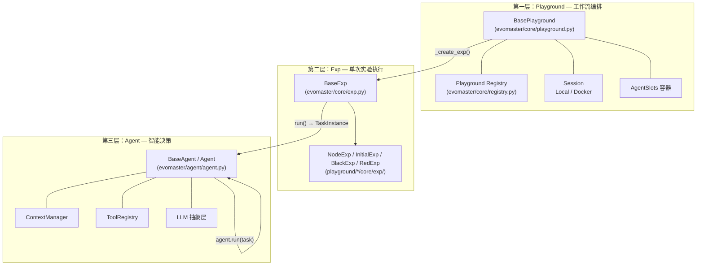
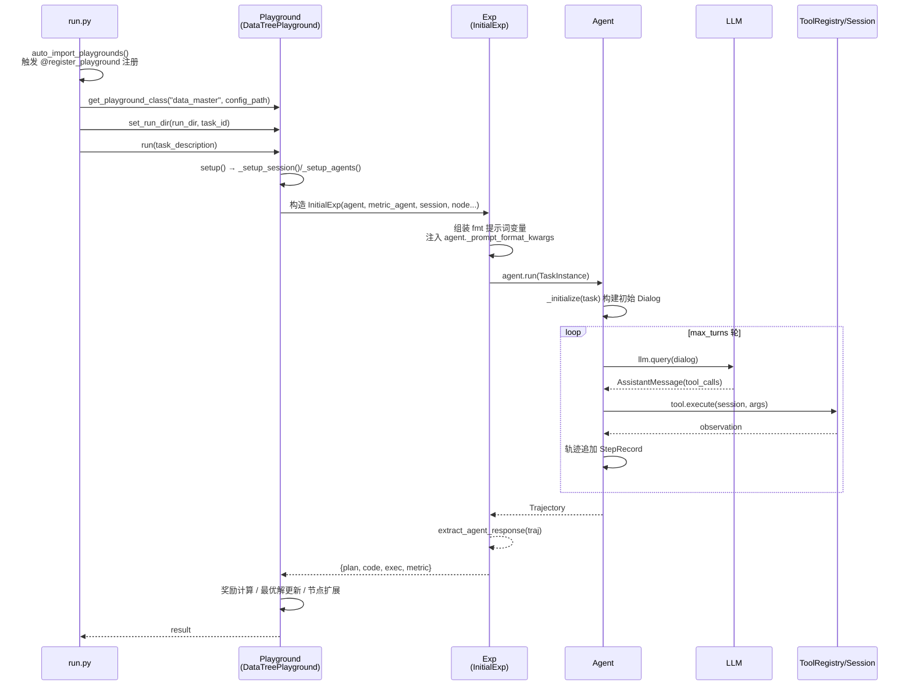

DataMaster 的执行引擎名为 EvoMaster，它采用严格分层的 **Playground → Exp → Agent** 三层架构来组织 LLM 智能体工作流：Playground 负责**工作流编排与生命周期管理**，Exp 负责**单次实验的任务实例化**，Agent 负责**LLM 对话与工具执行的智能决策**。本文面向中级开发者，从第一性原理出发解析三层各自的职责边界、协作契约与扩展点，帮助你理解"一次 DataTree 搜索任务"在代码层面究竟如何自顶向下流转。官方架构文档将这一分层概括为"编排 → 单实验执行 → 智能决策"的责任链条，本文将用仓库中的实际代码逐层验证并深化这一描述。
Sources: [architecture.md](docs/architecture.md#L26-L45)

> 📖 **小白导读**
> - 这篇讲什么：DataMaster 底层的 EvoMaster 框架把程序分成三层，分别负责"整体流程安排（Playground）""一次具体实验（Exp）""和大模型对话并调用工具（Agent）"，本文说明每层管什么、怎么互相配合。
> - 读之前先知道：**LLM**（大语言模型，也就是通过接口调用的 GPT 类服务）；**Agent**（智能体：一个反复"问 LLM、按回复调用工具、把结果再交给 LLM"的循环程序）；**prompt**（发给 LLM 的提示词文本）；**线程**（让多件事同时进行的机制）；**yaml**（一种写配置的文本格式）。
> - 读完能明白：一次搜索任务从命令行启动，到 LLM 调用工具、结果一层层返回，代码里是怎么流转的；并行时哪些东西共享、哪些东西各用各的。
> - 提醒：本文描述的是开源版里真实存在的 MLE-Bench（Kaggle 机器学习竞赛）流程；仓库 README 的 Roadmap 中提到的其他流程（如 PostTrainBench）标为"Coming soon"，代码里没有。

## 架构总览：三层职责与依赖方向

在深入实现之前，先建立整体心智模型。三层的依赖方向是**严格单向的**：Playground 持有并创建 Exp，Exp 持有并调用 Agent，Agent 持有 LLM 与 Session；反过来，Agent 从不感知自己被哪个 Exp 调用，Exp 也不感知自己被哪个 Playground 编排。这种单向依赖正是三层可以独立替换、独立测试的结构性保证。（名词提示：**Playground** 可以理解为"总导演"；**Exp**（experiment，实验）是"一次实验的执行单"；**Agent** 是"和 LLM 打交道的执行者"；**Session**（会话）是"命令实际运行的环境"，本地模式下就是在本机开子进程执行命令；**ToolRegistry** 是"工具登记表"，按名字查找工具。）



（上图前提说明：`BaseExp.run()` 将任务描述包装为 `TaskInstance` 后调用 `agent.run()`；Agent 内部执行 `_step()` 循环；Playground 通过工厂方法 `_create_exp()` 按需实例化 Exp。）

各层的核心契约可以用一张对照表概括：

| 维度 | Playground（编排层） | Exp（实验层） | Agent（智能层） |
| --- | --- | --- | --- |
| **核心问题** | "整个工作流如何组织？" | "这一次实验怎么跑？" | "这一步该做什么？" |
| **生命周期** | 跨任务长生命周期，管理 run_dir | 单次实验，用完即弃 | 单个对话（Dialog），跨 step 复用 |
| **核心入口** | `run(task_description)` | `run(task_description)` | `run(task: TaskInstance)` |
| **持有组件** | ConfigManager、Session、AgentSlots、SkillRegistry、MCP 管理器 | Agent 引用、config、node、workspace | LLM、Session、ToolRegistry、ContextManager |
| **并发单位** | 多 Worker 线程并行执行多个节点 | 每个并行节点一个 Exp 实例 | 每 Exp 一个 Agent（线程安全轨迹写入） |
| **产出物** | run 目录结构、最优解快照 | `{plan, code, exec, metric}` 结果字典 | `Trajectory`（完整对话轨迹） |

这一分层并非纸面设计，而是贯穿于包结构中：`evomaster/core/` 只包含 `BasePlayground` 与 `BaseExp` 两个基类及注册器，`evomaster/agent/` 独立成包，而所有具体实现（`DataTreePlayground`、`InitialExp` 等）都放在顶层 `playground/` 目录下，通过装饰器注册回来。基类与实现彻底解耦的布局，意味着你可以完全不动 `evomaster/` 代码就替换整条工作流。
Sources: [architecture.md](docs/architecture.md#L7-L24), [architecture.md](docs/architecture.md#L94-L103)

## 第一层：Playground —— 工作流编排与生命周期

### 生命周期四阶段

`BasePlayground` 在其类文档中明确声明了四阶段生命周期：**加载配置 → 初始化组件 → 创建并运行实验 → 清理资源**。体现在方法链上就是 `__init__()` → `setup()` → `_create_exp()` + `exp.run()` → `cleanup()`，由公开入口 `run()` 统一串联。

```python
# evomaster/core/playground.py 中 BasePlayground.run() 的写法（简化展示核心顺序；DataTreePlayground 覆写了 run()，见下文）
def run(self, task_description, output_file=None, images=None, on_step=None):
    try:
        self.register_thread()              # 注册日志过滤线程
        self.setup()                        # 初始化 Session + Agents
        self._setup_trajectory_file(output_file)  # 设定轨迹文件路径
        self._setup_raw_log_file()
        exp = self._create_exp()            # 工厂方法：创建实验
        result = exp.run(task_description, images=images, on_step=on_step)
        return result
    finally:
        self.cleanup()                      # 无论成败都清理资源
```

值得注意的是 `run()` 使用了 `try/finally` 结构保证 `cleanup()` 必然执行——这对于持有 Docker 容器（`DockerSession`）和 MCP 子进程的 Playground 尤其关键：如果中途抛异常而不清理，容器和 Node.js 桥接进程会泄漏。

要注意，上面是**基类**的 `run()`。DataMaster 实际使用的 `DataTreePlayground` 覆写了 `run()`（playground/data_master/core/playground.py:1138）：它不调用 `_create_exp()`，也不调用 `_setup_raw_log_file()`（所以默认不会产生 `raw_log.jsonl`），而是自己建立 UCT 搜索树并启动多个 Worker 线程循环（Worker 是"干活的线程"，详见下一篇文章）。
Sources: [playground.py](evomaster/core/playground.py#L1280-L1313), [playground.py](evomaster/core/playground.py#L128-L141)

### setup() 的组件装配

`setup()` 是编排层最核心的装配逻辑，基类版本按顺序执行两步：`_setup_session()` 创建执行环境（依据配置选择 `LocalSession` 或 `DockerSession`），`_setup_agents()` 遍历配置中的每个 agent 定义并逐一实例化。这里有一个容易忽略的设计细节：**Session 是全 Playground 共享的，但 LLM 是每个 Agent 独立的**——代码注释明确写道"Each Agent uses an independent LLM instance to ensure independent logging"，即每个 Agent 拥有独立的 LLM 实例以保证日志互不污染。工具方面稍有不同：`_create_agent` 每次都会调用 `_setup_tools()` 新建一份 ToolRegistry（evomaster/core/playground.py:527-591），但 MCP（一种让 Agent 调用外部工具程序的通信协议）连接只在第一次建立（`self.mcp_manager is None` 时），之后的 Agent 只是把同一个 MCP 管理器里的工具登记到自己的注册表里。也就是说，原文所说"ToolRegistry 被所有 Agent 复用"并不准确：复用的是 Session 和 MCP 连接，不是注册表对象本身。

`_setup_agents()` 的装配流程可以总结为：

| 步骤 | 方法 | 作用 |
| --- | --- | --- |
| 1 | `_get_agents_config()` | 从 ConfigManager 读取 agents 配置块 |
| 2 | `_setup_agent_llm(name)` | 读取该 agent 的 LLM 配置（模型、密钥等） |
| 3 | `_setup_agent_tools(name)` | 读取工具配置 `{builtin, mcp, custom}` |
| 4 | `_setup_agent_skills(name)` | 读取技能（skills，预先写好的可复用能力包）暴露列表；DataMaster 的 agent 配置里没有 `skills:` 键，实际没用到 |
| 5 | `_create_agent(...)` | 组装 LLM 实例 + AgentConfig + 提示词文件路径，实例化 `Agent` |
| 6 | `setattr(self.agents, f"{agent_name}_agent", agent)` | 按命名约定存入 AgentSlots |

AgentSlots 是一个继承自 `dict` 的特殊容器，同时支持 `self.agents["initial_agent"]` 与 `self.agents.initial_agent` 两种访问方式，并通过 `declare()` 方法预声明槽位名——子类在 `__init__` 中声明预期槽位，`setup()` 后再校验是否全部初始化，缺一即抛出 `ValueError`。这是一个轻量但有效的配置完整性检查机制。
Sources: [playground.py](evomaster/core/playground.py#L1011-L1025), [playground.py](evomaster/core/playground.py#L741-L766), [playground.py](evomaster/core/playground.py#L67-L126)

### 注册机制：`@register_playground` 装饰器

扩展能力来自 `evomaster/core/registry.py` 的注册器（"注册"就是把名字和类登记到一个全局字典里，之后按名字查找）。它维护一个全局字典 `_PLAYGROUND_REGISTRY`（`agent_name → Playground 类`），子类只需两行代码即可接入整个框架：

```python
@register_playground("data_master")
class DataTreePlayground(BasePlayground):
    ...
```

`get_playground_class(agent_name)` 在查询时有优雅降级：若该名字没有注册自定义类，则回退到 `BasePlayground` 本身——这意味着即使一个 agent 没有专属工作流，CLI 仍能以通用单 Agent 模式运行它。注册机制的另一半在入口文件 `run.py` 中：`auto_import_playgrounds()` 遍历 `playground/` 下所有子目录，动态导入 `playground.{agent_dir}.core.playground` 模块。由于 Python 的装饰器在导入时执行，这一步确保了所有注册代码在 CLI 启动时被触发，之后 `main()` 间接调用的 `run_single_task()` 才通过 `get_playground_class(agent_name, config_path=...)` 获取实例（run.py:213-230）。
Sources: [registry.py](evomaster/core/registry.py#L27-L53), [registry.py](evomaster/core/registry.py#L56-L84), [run.py](run.py#L400-L436), [run.py](run.py#L439-L450)

### 子类扩展点：以 DataTreePlayground 为例

`BasePlayground` 暴露了清晰的覆写点。`DataTreePlayground`（data_master 的工作流实现）展示了子类如何接管编排职责：它在 `__init__` 中声明五个 Agent 槽位（`initial/black/red/metric` 四个必需 + `nouse`），读取并行度配置（`session.local.parallel.max_parallel`，仅当 `parallel.enabled` 为真时才生效，否则只有 1 个 Worker）与消融开关（`use_red_node / use_memory / black_mode`，消融即"关掉某个组件看效果变化"，读自 yaml 的 `ablation` 段，没有该段时默认红节点、记忆都开启）；它覆写 `setup()`，在基类装配 Session 和 Agents 之后检查四个必需槽位是否齐全、写入数据相关环境变量、（若开启 test-feedback）创建测试集评分 agent、并建立数据软链接（symlink，一种指向别处文件的"快捷方式"）。评分服务（grading server，用来检查提交文件格式的小服务）的健康检查**不在** `setup()` 里，而是在它覆写的 `run()` 开头以及每个节点开始执行时（`_ensure_grading_server_ready`，playground.py:1141、871）；它不复用基类的 `_create_exp()`，而是在自己的 UCT 搜索主循环中**按节点类型动态实例化不同的 Exp**——initial 阶段用 `InitialExp`，black 阶段依据 `black_mode` 选 `BlackExp` 或 `RuleBlackExp`，red 阶段用 `RedExp`。这印证了编排层的本质：**Playground 决定"何时、以何种参数、创建哪个 Exp"，而非亲自执行实验**。
Sources: [playground.py](playground/data_master/core/playground.py#L44-L90), [playground.py](playground/data_master/core/playground.py#L520-L614), [playground.py](playground/data_master/core/playground.py#L279-L299)

## 第二层：Exp —— 单次实验的任务实例化

### BaseExp 的最小契约

`BaseExp` 是三层中最薄的一层——全部代码仅约 110 行，其 `run()` 方法完整逻辑只有三步：将任务描述包装为 `TaskInstance`、调用 `self.agent.run(task)`、把返回的 `Trajectory` 整理为结果字典并追加到 `self.results`。这种"薄"是刻意的：Exp 层的价值不在于复杂逻辑，而在于定义**"一次实验"的抽象边界**——它是工作流与智能体之间的稳定接口，实验的输入（task_description + task_id）与输出（trajectory + status + steps）在此定型。

```python
# BaseExp.run() 的核心三步（来自 evomaster/core/exp.py）
task = TaskInstance(task_id=task_id, task_type="discovery",
                    description=task_description, images=images or [])
trajectory = self.agent.run(task, on_step=on_step)
result = {"task_id": task_id, "status": trajectory.status,
          "steps": len(trajectory.steps), "trajectory": trajectory}
```

此外，`BaseExp` 还携带一个实用的 `exp_name` 属性：它通过类名约定自动推断实验名（去掉 `Exp` 后缀，如 `SolverExp` → `Solver`），供轨迹记录时区分不同实验来源。`evomaster/core/__init__.py` 的文档注释也给出了标准扩展方式——继承 `BaseExp` 覆写 `run()`，再在自定义 Playground 中覆写 `_create_exp()` 返回它。
Sources: [exp.py](evomaster/core/exp.py#L97-L175), [exp.py](evomaster/core/exp.py#L117-L128), [__init__.py](evomaster/core/__init__.py#L12-L24)

### NodeExp：面向 UCT 节点的领域扩展

data_master 并不直接使用 `BaseExp`，而是先在其上叠加一层领域基类 `NodeExp`。对比两者可以看出 Exp 层的扩展模式：

| 对比项 | BaseExp（通用） | NodeExp（data_master） |
| --- | --- | --- |
| 构造参数 | `(agent, config)` | `(agent, metric_agent, session, workspace, exp_id, data_preview, node, exp_index, ...)` |
| 额外持有 | — | metric_agent、workspace、UCT 节点引用、数据预览文本 |
| run() 职责 | 单 Agent 单任务 | 双 Agent 协作（主 Agent 产码 + Metric Agent 评分） |
| 特有能力 | 结果保存、响应提取 | `_run_metric_agent()` 解析验证集/测试集分数 |

`NodeExp` 引入的关键概念是**双 Agent 协作**：构造时同时接收主 Agent（生成代码的 initial/black/red agent）和 metric_agent（解析评分）。其 `_run_metric_agent(code, stdout)` 方法通过一个值得注意的技巧与 Agent 通信——它直接临时改写 `metric_agent._prompt_format_kwargs`（提示词格式化变量），注入 `{"code": ..., "stdout": ...}` 后调用 `agent.run(task)`，最后在 `finally` 块中恢复原始值。（所谓"占位符"，是提示词模板里形如 `{code}` 的空位，运行时用 Python 的 `str.format` 填入真实内容。）这种"借用提示词占位符传参"的模式贯穿所有 Exp 实现（`InitialExp.run()` 中同样先更新 `self.agent._prompt_format_kwargs.update(fmt)` 再调 `agent.run()`），是 Exp 层向 Agent 传递上下文的主要通道。
Sources: [__init__.py](playground/data_master/core/exp/__init__.py#L19-L35), [__init__.py](playground/data_master/core/exp/__init__.py#L37-L95), [initial_exp.py](playground/data_master/core/exp/initial_exp.py#L138-L173)

### InitialExp：一次实验的完整样貌

以 `InitialExp`（初始节点实验，负责生成第一版代码）为例，可以看清 Exp 层的完整职责链。它的 `run()` 依次完成：读取 dataloader 工具手册、operate 工具手册、memory tree 手册等提示词片段 → 依据 `initial_code` 与 `initial_instruction` 的有无组合，从四种模式模板（`mode_code_and_instruction / mode_code_only / mode_instruction_only / mode_free`）中选择并组装模式特定提示词 → 汇总为 `fmt` 字典注入 Agent 提示词变量 → 构造 `TaskInstance`（`task_type="initial"`）→ 调用 `agent.run(task, enable_final_turn=True, ...)` → 用 `extract_agent_response(traj)` 从轨迹中抽取最终答案 → 检查 Agent 是否通过工具生成了 `code_{node_id}_template.py` 和 `code_{node_id}_dataloader.py`（缺 template 只记一条警告，缺 dataloader 则会把 Agent 最终回复里的第一个代码块当作 dataloader 写入文件兜底）→ 用 `_assemble_code` 把 base_dataloader、dataloader、template 三段拼成完整脚本并运行 → 返回包含 `plan / code / raw_response / exec / metric / metric_detail` 的结果字典（其中 `plan` 恒为空字符串，initial_exp.py:220）。

举个具体例子：假设任务是 Kaggle 上的"猫狗图片分类"。InitialExp 先把"任务描述、数据预览、工具手册"填进 prompt，Agent 在最多 20 轮对话里读数据、写出 `code_xxx_template.py`（模型训练部分）和 `code_xxx_dataloader.py`（读数据部分），然后 Exp 自己把两段拼起来跑一遍，最后让 metric agent 从运行输出里读出验证集分数。

这里出现了 Exp 层的另一个重要契约：**Exp 对 Agent 的返回结果做"语义化后处理"**。Agent 只产出 Trajectory（原始对话流），而 Exp 负责从中提取结构化产物（代码、计划、执行结果）， Playground 再消费这些结构化结果做奖励计算与最优解维护。三层各自处理的数据形态在此完成了一次"对话流 → 领域结果"的转换。
Sources: [initial_exp.py](playground/data_master/core/exp/initial_exp.py#L21-L67), [initial_exp.py](playground/data_master/core/exp/initial_exp.py#L103-L180), [exp.py](evomaster/core/exp.py#L13-L94)

## 第三层：Agent —— LLM 对话循环与工具执行

### run() 与 _step()：两层的执行循环

`BaseAgent`（抽象基类）与 `Agent`（标准实现）构成了智能决策核心。`run(task)` 是公开入口，其内部是一个不超过 `config.max_turns` 轮的循环，每轮调用一次 `_step()`：

- `_step()` 首先调用 `context_manager.prepare_for_query()` 准备查询用对话（可能触发截断或压缩）；若发生永久压缩则回写 `current_dialog` 并同步更新 `trajectory` 引用；
- 随后调用 `self.llm.query(dialog_for_query)` 获取助手消息，若抛出 `ContextOverflowError` 则执行**紧急压缩后重试**（被动恢复），并在成功后依据 usage 主动检查是否接近 token 上限以提前压缩（主动防护）；
- 若助手消息不含工具调用，且 Agent 处于 `enable_tools=False` 或 `finish_on_text_response=True` 配置下，直接结束；否则注入一条催促继续的用户消息；
- 若含工具调用，则逐个处理：`finish` 工具设置结束标志（其参数只被打印到日志，agent.py:453-466）；`ask_user` 工具触发暂停等待人工输入；其余工具交由 `_execute_tool()` 执行，输出超过 30000 字符时首尾各截取一半保留；
- 每轮的 `StepRecord` 追加进 `Trajectory` 并实时落盘到轨迹文件。

补充说明：Exp 调用 `agent.run(..., enable_final_turn=True, ...)` 时，`run()` 只会在**最后一轮**（第 `max_turns` 轮）开始前注入一条"这是最后一轮，请直接给出方案和代码块"的用户消息（agent.py:180-184）；如果 Agent 在中途就调用了 `finish`，这条消息根本不会出现。另外，若用完 `max_turns` 仍未调用 `finish`，轨迹状态记为 `failed`（原因 `max_turns_exceeded`）。

`_execute_tool()` 的实现极为直接：从 `self.tools`（ToolRegistry）按名取出工具实例，调用 `tool.execute(self.session, tool_args)`——注意工具执行依赖的正是第一层创建、全 Playground 共享的那个 Session。工具未注册或执行异常都被捕获并转为错误观测值返回给 LLM（"观测值"就是工具执行后返回给 LLM 的文字结果），而非中断整个实验，这保证了 Agent 循环的鲁棒性。
Sources: [agent.py](evomaster/agent/agent.py#L153-L218), [agent.py](evomaster/agent/agent.py#L346-L533), [agent.py](evomaster/agent/agent.py#L535-L577)

### Agent 与 BaseAgent：抽象与标准实现

`BaseAgent` 定义了智能体的四项基础能力——对话管理（Dialog）、轨迹记录（Trajectory）、工具调用执行、上下文管理，并声明两个必须由子类实现的抽象方法：`_get_system_prompt()` 与 `_get_user_prompt(task)`。标准实现 `Agent` 的贡献在于**提示词模板化**：构造时接收 `system_prompt_file` / `user_prompt_file` 与 `prompt_format_kwargs`，从文件加载模板并用 `{}` 占位符格式化。`_get_system_prompt()` 会在模板基础上动态追加当前工作目录信息（"You must perform all operations in this directory..."），确保 LLM 知道自己的操作边界；`_get_user_prompt()` 则将 `task_id / task_type / description / input_data` 与额外的格式化变量一并注入用户提示词；如果模板里有变量没被提供（`KeyError`），它不会报错，而是**悄悄返回未替换的原模板**（agent.py:1242-1244），所以排查"提示词里出现了没被替换的 `{xxx}`"时要先看这里。

`AgentConfig` 仅含三个字段：`max_turns`（类定义里的默认值是 100，但经 Playground 的 `_create_agent` 创建时，yaml 没写就取 20（`agent_config.get('max_turns', 20)`，evomaster/core/playground.py:872）；data_master 的 yaml 中 initial 为 20、black/red 为 50、metric 为 4——metric 只需少量轮次即可完成分数解析；注意"一轮"是一次 LLM 调用加其工具执行）、`context_config`（上下文压缩策略）、`finish_on_text_response`（纯文本回复即完成任务，适用于对话式场景）。这套参数在 Playground 的 `_create_agent()` 中从 YAML 配置逐 agent 读取并实例化，完成了"配置 → 行为"的映射。
Sources: [agent.py](evomaster/agent/agent.py#L52-L64), [agent.py](evomaster/agent/agent.py#L39-L49), [agent.py](evomaster/agent/agent.py#L1139-L1198), [agent.py](evomaster/agent/agent.py#L1220-L1249)

### 并行场景下的 Agent 复制

当 Playground 以多 Worker 并行执行 UCT 节点时，每个 Worker 需要独立的 Agent 实例——但"独立"是有精确边界的。`BasePlayground.copy_agent()` 的实现揭示了这一契约：新 Agent 获得**独立的 LLM 实例**（总是新建而非共享，避免日志混杂）、**独立的上下文状态**（`current_dialog=None`、`trajectory=None`、`_step_count=0` 全部重置），同时**共享** session、tools、skill_registry、config_dir 与已解析好的系统/用户提示词模板。换言之，并行安全性的实现策略是：会话状态隔离、重资源复用。需要提醒的是，DataMaster 默认配置下 4 个并行 Worker 仍共用同一个工作目录（`split_workspace_for_exp: false`），Agent 之间只是对话上下文互不干扰，文件层面并没有隔离，写同名文件时可能互相覆盖（推断）。轨迹文件写入则由类级锁 `_trajectory_file_lock` 保护，多个 Agent 实例并发写同一文件时按 `agent_id` 合并条目、互不覆盖。
Sources: [playground.py](evomaster/core/playground.py#L935-L1009), [agent.py](evomaster/agent/agent.py#L66-L78), [agent.py](evomaster/agent/agent.py#L1061-L1114)

## 层间协作：一次完整调用的时序

将三层的调用关系压缩成一张时序图，可以完整看到从 CLI 命令到工具执行的每一次跨层跃迁：



（上图前提说明：图中以 data_master 的 initial 节点为例；black/red 节点的差异仅在于 Exp 类型与传入参数，层间接口完全一致。）

两个值得强调的跨层契约在此显形：**Exp → Agent 的传参通道是 `_prompt_format_kwargs` + `TaskInstance`**（前者注入提示词上下文，后者标识任务身份）；**Playground → Exp 的传参通道是构造函数注入**（agent、metric_agent、session、workspace、node 一次性给齐）。这两条通道定义了三层的集成面，也定义了二次开发时你需要实现的全部接口。
Sources: [run.py](run.py#L250-L276), [playground.py](playground/data_master/core/playground.py#L520-L543), [initial_exp.py](playground/data_master/core/exp/initial_exp.py#L157-L173)

## 同一基座，两种工作流：data_master 与 ml_master

三层架构的价值最终体现在"换工作流不换基座"上。仓库中两个已注册的 Playground 是最好的对照组——两者共享 `BasePlayground` 的全部基础设施（Session 管理、Agent 装配、注册机制），仅替换编排策略与 Exp 集合：

| 对比维度 | DataTreePlayground（data_master） | MLMasterPlayground（ml_master） |
| --- | --- | --- |
| **注册名** | `"data_master"` | `"ml_master"` |
| **Agent 槽位** | initial / black / red / metric | draft / debug / improve / metric |
| **Exp 类型** | InitialExp、BlackExp、RuleBlackExp、RedExp | DraftExp、DebugExp、ImproveExp |
| **搜索机制** | UCT 搜索 + DataTree + 记忆树 + Data Pool | UCT 搜索 + 解决方案树（MCTS 风格） |
| **特有能力** | 红节点数据下载、组件消融开关、test-feedback | 精简版，复用 BasePlayground 全部设施 |
| **共同继承** | `_setup_session()` / `_setup_agents()` / `copy_agent()` / 注册机制 | 同左 |
| **步数上限** | 来自 yaml 的 `max_steps` | 代码里写死为 `max_steps = 40`（ml_master/core/playground.py:234） |

两者的 `__init__` 结构几乎逐行同构：声明槽位 → 读取并行配置 → 进入各自的搜索主循环。差异全部集中在"编排策略"这一维度，而 Agent 层（同一个 `Agent` 类）、Exp 基类（同一个 `BaseExp`，两个工作流各自再写一个继承它的 `NodeExp`）、Session（同一个 `LocalSession`）完全复用——这正是关注点分离带来的直接收益。官方 playground 目录的 README 也明确了这两个工作流的定位：`ml_master` 是 MLE-Bench 风格的基线机器学习工作流，`data_master` 是包含 DataTree、Data Pool、全局记忆与红黑节点的主工作流。
Sources: [playground.py](playground/data_master/core/playground.py#L44-L90), [playground.py](playground/ml_master/core/playground.py#L32-L60), [README.md](playground/README.md#L5-L11)

## 设计原理分析：为什么是三层

回到第一性原理，三层划分回答了三个正交的问题。**时间尺度不同**：Playground 的生命周期跨越整个 run（数小时），Exp 的生命周期是一次节点实验（数分钟），Agent 的生命周期是一个对话循环（数秒至数分钟）（以上时长为作者的粗略估计，未验证）——生命周期不同的组件若混杂在一起，资源管理会互相纠缠。**失败域不同**：一个节点的 Exp 失败不应影响其他节点的 Exp（data_master 中节点执行抛出的异常会被捕获，由 `_create_error_result` 转成一个 `exit_code=-1`、`metric=None` 的错误结果，该节点按 bug 处理，其他节点照常继续，见 playground.py:906-908、962-971），一个 Agent 的上下文溢出不应拖垮整个工作流（紧急压缩重试机制兜底）。**变化频率不同**：换实验策略改 Exp 子类，换 LLM 行为改 Agent 配置，换工作流改 Playground——三种演进方向互不干扰。

官方架构文档总结的四项设计原则中，"线程安全"一项值得单独展开：**每个 Exp 拥有独立 Agent 实例，并行发生在 Playground 层，轨迹记录线程安全**。实现层面由三处机制协同保证——Playground 的 `register_thread()` 配合 `_SessionThreadFilter` 按线程归属过滤日志（线程池复用线程时新注册覆盖旧映射）；`copy_agent()` 的"独立 LLM + 共享 Session"策略；以及 `BaseAgent` 的类级文件锁保护轨迹合并写入。若你计划扩展并行能力，这三处是需要重点理解的既有基础设施。
Sources: [architecture.md](docs/architecture.md#L94-L113), [playground.py](evomaster/core/playground.py#L30-L64), [playground.py](playground/data_master/core/playground.py#L606-L614)

## 小结与延伸阅读

EvoMaster 三层架构的本质是一条**自上而下的责任委托链**：CLI 依据注册表实例化 Playground，Playground 装配共享资源并编排 Exp，Exp 包装任务并驱动 Agent，Agent 循环调用 LLM 与工具产生 Trajectory，结果再沿原路逐层语义化上传。掌握 `_create_exp()`、`_prompt_format_kwargs` 注入、`copy_agent()` 这三个集成点，你就掌握了在任意一层插入自定义行为的全部钥匙。

按照知识依赖关系，建议接下来阅读：

- [DataTree 搜索流程全解析：从初始化到并行搜索](7-datatree-sou-suo-liu-cheng-quan-jie-xi-cong-chu-shi-hua-dao-bing-xing-sou-suo) —— 理解 DataTreePlayground 如何在三层基座上构建 UCT 主循环
- [Agent 基类：对话管理、轨迹记录与上下文截断策略](19-agent-ji-lei-dui-hua-guan-li-gui-ji-ji-lu-yu-shang-xia-wen-jie-duan-ce-lue) —— 深入第三层的上下文压缩与轨迹细节
- [Agent 内置工具（Bash / Editor / Think / Finish）与 MCP 协议集成](17-agent-nei-zhi-gong-ju-bash-editor-think-finish-yu-mcp-xie-yi-ji-cheng) —— 了解 Agent 调用的工具系统全貌
- [二次开发指南：注册自定义 Playground、Exp 与 Agent](30-er-ci-kai-fa-zhi-nan-zhu-ce-zi-ding-yi-playground-exp-yu-agent) —— 将本文的架构理解转化为实践
