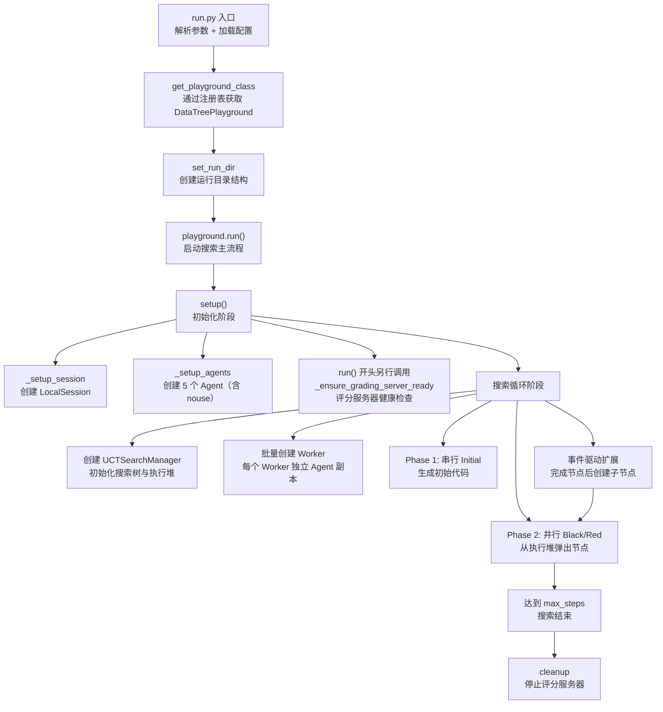
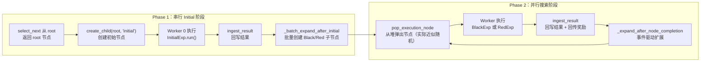

DataTree 是 DataMaster 框架的核心搜索引擎，它将蒙特卡洛树搜索（MCTS/UCT）的思想引入数据工程领域：以"初始代码生成 → 数据增强 → 外部数据引入"为三阶段节点扩展路径，在验证指标反馈的驱动下，通过 UCT 算法平衡探索与利用，自动搜索最优数据流水线方案。本文将从入口函数出发，逐层剖析 DataTree 的初始化、搜索树构建、节点选择、并行执行到结果回传的完整流程，帮助开发者理解搜索循环的每一个关键环节。

> 📖 **小白导读**
> - 这篇讲什么：DataMaster 怎么"一边尝试、一边打分、一边长出新的尝试"，自动找到更好的数据处理方案；重点是搜索主循环（`DataTreePlayground.run()`）的每一步。
> - 读之前先知道：**MCTS/UCT**（蒙特卡洛树搜索 / 置信上界树搜索：把每次尝试画成树上的一个节点，用一个公式在"多试没试过的方向（探索）"和"深挖已知效果好的方向（利用）"之间权衡）；**节点**（树上的一次尝试，含代码、分数）；**worker**（干活的线程，同时跑多个）；**metric**（评价指标，如验证集分数）；**stdout**（程序运行时打印的文字输出）；**线程锁**（防止多个线程同时改同一份数据的"门闩"）。
> - 读完能明白：程序启动后依次发生了什么；节点怎么创建、执行、打分、回传；`max_steps` 到底数什么；以及代码里几处和直觉不同的地方（例如 Phase 2 实际并不按 UCT 值挑节点）。
> - 提醒：开源版只有 MLE-Bench（Kaggle）这一条流程，仓库 README 的 Roadmap 把 PostTrainBench 标为"Coming soon"。

## 全局流程概览

理解 DataTree 搜索流程的第一步是把握从命令行到搜索完成的整体链路。整个过程分为两大阶段：**初始化阶段**负责配置加载、会话创建、Agent 实例化和评分服务器就绪；**搜索循环阶段**在 Worker 线程中反复执行"选择节点 → 运行实验 → 回写结果 → 扩展子节点"的闭环。

上面的流程图展示了从入口到完成的完整调用链。接下来我们深入每个阶段的实现细节。

Sources: [run.py](run.py#L1-L111), [playground.py](playground/data_master/core/playground.py#L1138-L1221)

## 入口与 Playground 加载

DataTree 搜索的入口是 `run.py`，它通过 `argparse` 解析命令行参数后调用 `run_single_task` 函数。该函数通过框架注册表机制获取 Playground 实例。

`run_single_task` 的核心流程为：首先通过 `get_playground_class(agent_name, config_path=config_path)` 从全局注册表中获取已注册的 Playground 类。DataTreePlayground 通过 `@register_playground("data_master")` 装饰器在模块加载时自动注册到 `_PLAYGROUND_REGISTRY` 字典中。获取实例后，依次调用 `set_run_dir`（创建运行目录结构）、`set_initial_config`（设置初始代码/指令）和 `set_test_feedback_config`（设置测试反馈模式），最后调用 `playground.run(task_description=task_description)` 启动搜索。

Sources: [run.py](run.py#L213-L285), [registry.py](evomaster/core/registry.py#L27-L84)

## 初始化阶段：setup() 的四步装配

DataTreePlayground 的 `setup()` 方法被 `run()` 调用，完成搜索前的大部分准备工作（评分服务检查是紧接着在 `run()` 里做的，见第四步）。这个过程包含四个关键步骤：

**第一步：会话创建**。`_setup_session()` 读取配置中的 session 类型（`local` 或 `docker`），创建对应的 `LocalSession` 或 `DockerSession`（Session 就是"命令在哪里执行"的环境；local 即直接在本机开子进程）。对于本地会话，会从配置中提取 `workspace_path`、`working_dir`、`timeout` 以及 `parallel` 相关参数。DataTreePlayground 在 `__init__` 中就从 `parallel_config` 读取了 `max_parallel` 值，决定后续 Worker 线程数量（仅当 `parallel.enabled` 为真，否则只有 1 个；基础配置里 `enabled: true`、`max_parallel: 4`，config_base.yaml:158-162）。

**第二步：Agent 实例化**。`_setup_agents()` 遍历配置中的每个 Agent 定义（yaml 里共有 `nouse`、`initial`、`black`、`red`、`metric` 五个；`nouse` 是排在最前、带 MCP 配置的占位 agent，MCP 连接会在它创建时初始化一次，之后其他 agent 复用这个连接，所以 initial/black/red 看到的是同一套完整的 MCP 工具，只是各自的 prompt 引导它们用不同的工具），为每个 Agent 创建独立的 LLM 实例，并登记工具，然后通过 `_create_agent` 方法组装成 `Agent` 对象。MCP 是一种让 Agent 通过标准协议调用外部"工具程序"（如搜索、提交文件操作）的机制。每个 Agent 的 prompt 文件路径会被解析为绝对路径，`prompt_format_kwargs` 被传入用于后续模板渲染。

**第三步：必需 Agent 校验**。DataTreePlayground 的 `setup()` 在 `_setup_session` 和 `_setup_agents` 之后，额外检查 `initial_agent`、`black_agent`、`red_agent`、`metric_agent` 四个必需 slot 是否已初始化，缺失则抛出 `ValueError`；随后写入环境变量（`ML_MASTER_DATA_EXPID`、`ML_MASTER_DATA_ROOT`）、（开启 test-feedback 时）创建测试集评分 agent，并调用 `_ensure_prepared_links` 在工作目录里建立指向 `prepared/` 下 `baseline.json`、`grade.py`、`public/` 的软链接（symlink，类似"快捷方式"）。

**第四步：评分服务器就绪**。这一步其实不在 `setup()` 内，而是在 `run()` 里 `setup()` 之后立刻调用（playground.py:1141），并且每个节点开始执行前还会再调一次（:871）。`_ensure_grading_server_ready()` 先检查配置中唯一的 grading server URL 的健康状态（通过 `/health` 端点；评分服务是一个用来检查提交文件格式是否合法的小服务），如果不健康则尝试在同一端口重启评分服务器进程。注意：重启用的 runner 脚本路径少了 `playground/` 一层（playground.py:190-196 的 `project_root / "search_dataset_tools" / ...`），该文件不存在，所以"自动重启"在当前仓库里会走到 `RuntimeError`，评分服务需要事先自己准备好。另外还有一个嵌入式版本（`core/utils/grading_server.py`），在节点结算时由 `validate_submission` 按需拉起。

Sources: [playground.py](playground/data_master/core/playground.py#L279-L312), [BasePlayground](evomaster/core/playground.py#L1011-L1025), [config_base.yaml](configs/data_master/config_base.yaml#L158-L162)

## UCT 搜索树数据结构

搜索的核心数据结构是 `UCTNode` 和 `UCTSearchManager`，它们共同构成了 MCTS 的树状态管理。

### UCTNode：树节点状态

每个 `UCTNode` 实例承载以下几类信息：

| 属性类别 | 核心字段 | 说明 |
|---------|---------|------|
| **阶段标识** | `stage`, `id`, `parent` | 节点类型（root/initial/black/red）与树结构链接 |
| **执行内容** | `plan`, `code`, `stdout`, `exit_code` | Agent 生成的方案、代码及运行结果 |
| **评估状态** | `metric`, `is_buggy`, `is_valid`, `grading_status` | 指标值、bug 状态、评分结果 |
| **树统计** | `visits`, `total_reward`, `children`, `expected_child_count` | UCT 所需的访问次数、累积奖励、子节点集合 |
| **搜索控制** | `is_terminal`, `continue_improve`, `locked` | 终止标记、改进标记、锁定状态（防并行重复执行） |

节点的扩展上限由 `is_fully_expanded(cfg)` 方法控制：root 节点只允许创建一个 initial 子节点；buggy 节点最多允许 3 个修复子节点；非 buggy 的 initial/black/red 节点最多创建 `num_black + num_red`（默认 5+1=6）个子节点。

Sources: [uct.py](playground/data_master/core/utils/uct.py#L320-L410)

### UCTSearchManager：搜索状态管理器

`UCTSearchManager` 是搜索的中央控制器，初始化时创建一个虚拟 root 节点，并维护以下关键状态：

- **`execution_heap`**：基于 UCT 值的最大堆（`UCTMaxHeap`），在 Phase 2 阶段用来弹出待执行节点。堆（heap）是一种"每次能快速取出最大/最小元素"的数据结构。堆内部使用 `threading.Lock` 保证线程安全，存储 `(−uct_value, node_id)` 元组利用 Python 的最小堆实现最大堆语义。**关键细节**：UCT 值只在节点 `push` 进堆的那一刻计算一次（uct.py:274-281），之后不再更新；而新建节点 `visits=0`，UCT 值为 `inf`（无穷大），因此所有新节点的堆键都是 `(-inf, node.id)`，比较时退化为比较 `node.id`（一个随机 UUID），实际出堆顺序近似随机，既不是按 UCT 优先级，也不是先进先出。
- **`best_node` / `best_metric`**：全局最优节点及其指标值，在每次 `ingest_result` 时更新。
- **`current_step`**：已完成（回写过结果）的节点计数，在 `ingest_result` 末尾加一（uct.py:850），用于探索系数衰减和步数限制判断；initial 节点也计入。

Sources: [uct.py](playground/data_master/core/utils/uct.py#L496-L534), [uct.py](playground/data_master/core/utils/uct.py#L261-L315)

## 搜索主循环：run() 方法详解

DataTreePlayground 的 `run()` 方法是整个搜索的编排核心。其执行流程可以分解为以下步骤：

1. **调用 `setup()`** 完成初始化（注意：`DataTreePlayground.run()` 覆写了基类，不调用 `_setup_raw_log_file()`，所以默认不产生 `raw_log.jsonl`）
2. **确保评分服务器就绪**（`_ensure_grading_server_ready`）
3. **设置轨迹文件**（`_setup_trajectory_file`）
4. **创建工作空间目录结构**（`_setup_workspace_directories`）：创建 `working`、`best_solution`、`best_submission`、`data_links`、`submission` 等子目录
5. **创建 UCT 搜索管理器**（`_create_search_manager`）：实例化 `UCTSearchManager`，注入评分回调函数和快照回调
6. **初始化搜索状态**（`_initialize_search_state`）：包含 `code`、`metric`、`node_id`、`dispatch_id`、`active_jobs`、`initial_completed` 等状态变量；并读取 `max_steps`（yaml 里的 `max_steps`，由生成配置时填入，默认流程里是 150，未验证）
7. **创建 Worker Agent 副本**：为每个 Worker 索引创建独立的 `initial`、`black`、`red`、`metric` Agent 副本，确保线程隔离
8. **启动并行 Worker 循环**（`execute_parallel_tasks`）

Sources: [playground.py](playground/data_master/core/playground.py#L1138-L1221)

## 两阶段执行模型：Phase 1 与 Phase 2

DataTree 的搜索执行采用**两阶段模型**，由 `best_state["initial_completed"]` 标志位切换。

### Phase 1：串行 Initial 阶段

在 Initial 节点完成之前，只有 Worker 0 可以工作，其他 Worker 处于等待状态。Worker 0 通过 `select_next()` 从 root 节点获取扩展目标，创建 initial 子节点并执行。Initial 完成后，Worker 0 再次调用 `select_next()`（这是整个程序里**唯一**调用 `select_next` 的地方，playground.py:775），它顺着树走到 initial 节点，`_batch_expand_after_initial` 方法根据 `_select_stages_batch` 的结果一次性创建所有 Black/Red 子节点（默认 5 个 black + 1 个 red），将它们推入执行堆，并将 `initial_completed` 设为 `True`。即使 initial 节点本身有 bug，也仍然走这个批量扩展（只是日志里打一条警告），并不会只创建"修复"节点。

`_select_stages_batch` 的逻辑根据父节点状态决定创建哪些子节点：

| 父节点状态 | 创建的子节点 | 说明 |
|-----------|-------------|------|
| root | `[("initial", ...)]` | 唯一的初始节点 |
| buggy 且子节点≥3 | `[("terminal", ...)]` | buggy 超过重试上限，终止 |
| 其他（含 buggy 但子节点<3） | 补足到 `num_red` 个 red + `num_black` 个 black | 若 `use_red_node=False` 则跳过 red；关闭红节点后仍然是最多 5 个 black 子节点，并不会变成二叉结构 |

Sources: [playground.py](playground/data_master/core/playground.py#L765-L847), [playground.py](playground/data_master/core/playground.py#L446-L500)

### Phase 2：并行搜索阶段

Phase 2 中所有 Worker 平等竞争执行堆中的节点。`_handle_phase2` 调用 `search_mgr.pop_execution_node()` 从执行堆中弹出一个节点。**注意：Phase 2 完全不调用 `select_next`，也就不会沿树做 UCT 选择**；弹出顺序由堆键 `(-uct, id)` 决定，而因为键里的 UCT 值在入堆时算一次、且新节点一律是 `inf`，实际上等价于按随机 id 出堆（见上文 `execution_heap` 的说明）。如果堆为空但仍有活跃任务（`active_jobs > 0`），Worker 进入等待；如果堆为空且 `active_jobs == 0`，Worker 退出循环。

不过 `active_jobs` 的计数方式是：批量扩展时 `+len(...)`（:843）、事件驱动扩展每建一个节点 `+1`（:1074/:1092/:1119）、phase 2 弹出节点时再 `+1`（:815），而节点完成时只 `-1`（:911）。也就是说同一个节点被"计了两次加、一次减"，`active_jobs` 只增不回零，"堆空且 active_jobs==0 就退出"在 Phase 2 里实际不会触发，搜索主要靠 `current_step >= max_steps` 结束（推断，未实测）。

Worker 获取到节点后，在 `_execute_and_process_node` 中完成完整的执行-处理-扩展流程。

Sources: [playground.py](playground/data_master/core/playground.py#L803-L816)

## 节点执行全流程：_execute_and_process_node

这是单个节点从执行到回写的核心方法，包含以下步骤：

**1. 准备阶段**。先再次确保评分服务可用，然后从节点对象中提取 `stage`、父节点的 `code` 和 `stdout`，获取全局最佳代码和指标。如果启用了 Memory（`use_memory=True`），通过 `parent_node.fetch_child_memory()` 获取兄弟节点的执行摘要作为上下文记忆。这份摘要里每条以 `Design: {child.plan}` 开头，但各 Exp 返回的 `plan` 都是空字符串，所以 Design 恒为空；有用的部分是 `Results:`（取自节点的 `analysis`，即该节点 stdout 的最后 500 个字符）和验证指标。

**2. 节点执行**。通过 `_run_one_node` 方法根据 stage 类型分派到对应的实验类：

| Stage | 实验类 | 核心行为 |
|-------|-------|---------|
| `initial` | `InitialExp` | 根据四种模式（code+instruction/code-only/instruction-only/free）组装 prompt，生成模板和 DataLoader 代码 |
| `black` | `BlackExp` 或 `RuleBlackExp` | 从父节点继承模板，进行数据增强/特征工程 |
| `red` | `RedExp` | 搜索外部数据集并集成到现有流程中 |

所有实验类继承自 `NodeExp`（进而继承 `BaseExp`），执行后返回包含 `plan`、`code`、`raw_response`、`exec`、`metric`、`metric_detail` 的字典（Black/Red 若找不到父节点的 template，会直接返回只含 `error` 的字典，随后被当作 bug 节点处理）。未知 stage（如 `terminal`）返回一个"TERMINATE"的占位错误结果。整个 `_run_one_node` 抛出的异常会被捕获并转成 `exit_code=-1` 的错误结果，不会让整个搜索崩溃。节点执行过程本身不持有 `state_lock`，所以多个 Worker 才能真正并行运行。

**3. 结果回写**。在 `state_lock` 保护下，将执行结果写回节点对象，构建 `MetricReview`（`build_review`：`is_bug = detail.is_bug 或 metric 为 None`，不看有没有提交文件；`summary` 取 stdout 最后 500 个字符，metric agent 自己返回的 summary 被丢弃），调用 `search_mgr.ingest_result(node, review)` 完成指标回传、奖励计算和访问统计更新。

**4. 最佳解更新**。如果 `search_mgr.best_node` 发生变化且与当前 `best_state` 不同，调用 `_update_best_solution` 保存最佳代码和提交文件。

**5. 事件驱动扩展**。如果 Phase 2 已开始（`initial_completed` 为真；所以 initial 节点自己完成时不走这里），调用 `_expand_after_node_completion` 创建新的子节点并推入执行堆，保持搜索持续进行。

Sources: [playground.py](playground/data_master/core/playground.py#L849-L960), [playground.py](playground/data_master/core/playground.py#L502-L614)

## UCT 节点选择与回传

### select_next：树遍历选择

（再次提醒：这一小节描述的 `select_next` 与 `_uct_select` 在整个程序里只在 Phase 1 被调用，用来从 root 走到 initial 节点；Phase 2 的节点由执行堆弹出，不经过它们。第 9 篇会更详细讨论 UCT。）

`select_next` 从指定节点（默认 root）开始，沿树向下遍历直到找到一个可扩展的节点。遍历逻辑如下：

- 如果当前节点**未完全扩展**：检查特殊条件（buggy debug 成功、continue_improve），不满足则直接返回当前节点进行扩展
- 如果当前节点**已完全扩展**：通过 `_uct_select` 从子节点中选择 UCT 值最大的节点继续遍历
- 如果没有可选子节点，返回 `None`

`_uct_select` 在选择时优先考虑非 buggy、非 terminal 的子节点；如果没有理想的子节点，会尝试选择可扩展的 buggy 节点作为 fallback。

Sources: [uct.py](playground/data_master/core/utils/uct.py#L597-L644), [uct.py](playground/data_master/core/utils/uct.py#L965-L1048)

### ingest_result：结果回传与奖励计算

`ingest_result` 是搜索反馈的核心方法，执行以下操作：

**指标解析与状态更新**。将 `MetricReview` 中的信息写入节点：`is_buggy` 仅由 `review.is_bug` 决定（`ingest_result` 自己不因 metric 缺失而判死，只赋 `WorstMetricValue` 并在分析里记一笔）。但要注意上游 `build_review` 已经把"metric 为 None"算进了 `is_bug`（`is_bug = detail.is_bug or metric is None`），所以实际运行中 metric 缺失的节点仍然是 buggy。如果与最佳节点的指标方向（越大越好还是越小越好）冲突，则标记为 buggy。

**评分服务器验证**。如果节点非 buggy 且存在提交文件（`submission_{node.id}.csv`），调用 `grader`（即 `validate_submission`）验证提交格式。关键设计：grader 返回 `invalid` 才标记 buggy；grader 不可用（`server_unavailable`）不等于 buggy，只记录警告。

**奖励计算**。`_get_node_reward` 的奖励策略：
- buggy 或无 metric：返回 `−1.0`
- 基础奖励：`1.0`
- 父节点 buggy 但当前成功：额外 `+1.0`
- 超越全局最佳（已存在最佳节点时）：额外 `+1.0`

所以单个节点的奖励范围是 -1 到 3。

**回传**。`_backpropagate` 从当前节点沿 `parent` 链向上，对每个祖先节点（包括虚拟 root）调用 `update_reward(reward)`（`visits += 1`, `total_reward += reward`）。这就是"把这次尝试的成绩记到整条祖先链上"。

Sources: [uct.py](playground/data_master/core/utils/uct.py#L646-L851), [uct.py](playground/data_master/core/utils/uct.py#L862-L904)

## UCT 值计算与探索系数衰减

### UCT 值公式

节点 UCT 值的计算在 `UCTNode.uct_value` 中实现：

$$UCT = \frac{total\_reward}{visits} + c \cdot \sqrt{\frac{\ln(parent\_visits)}{visits}} - penalty$$

对于未访问节点（`visits == 0`），返回 `float("inf")`（buggy 节点减去惩罚值，但 `inf - 1000` 仍是 `inf`，所以对新节点惩罚实际无效）。buggy 节点的惩罚值默认为 1000.0（`buggy_penalty`），从已访问节点的 UCT 值中减去，使其优先级远低于非 buggy 节点。公式里的 $c$ 是探索系数，越大越鼓励尝试少访问的分支。

Sources: [uct.py](playground/data_master/core/utils/uct.py#L415-L445)

### 探索系数衰减策略

`_exploration_constant` 方法根据 `UCTDecayConfig` 的 `decay_type` 字段选择不同的衰减策略：

| 衰减类型 | 公式 | 特点 |
|---------|------|------|
| `constant` | $c$ | 不衰减 |
| `linear` | $\max(c_0 - \alpha \cdot t, lower)$ | 线性递减 |
| `exponential` | $\max(c_0 \cdot \gamma^t, lower)$ | 指数递减 |
| `piecewise` | 分段：$t < t_1$ 保持 $c_0$；$t_1 \leq t \leq t_2$ 线性衰减；$t > t_2$ 取下限 | 默认策略；设计意图是前 30% 探索、后 30% 利用，但实际有偏差，见下 |
| `dynamic_piecewise` | 基于时间进度动态估算 $t_1$, $t_2$ | 适配时间限制场景 |

默认配置为 `piecewise`，初始探索系数 1.414（约等于 $\sqrt{2}$），下限 0.5，分段比例 (0.3, 0.7)。需要注意：代码里分界点是 `t1 = round(0.3 * max(current_step, 1))`、`t2 = round(0.7 * max(current_step, 1))`（uct.py:1062-1072），也就是用**当前步数**而不是 `max_steps` 来算，而 `t` 也正是当前步数，所以 `t` 很快就大于 `t2`，推算当 `current_step >= 2` 时 $c$ 恒为下限 0.5（推断）。衰减参数使用 `UCTDecayConfig()` 的默认值（playground.py:652），yaml 里不能覆盖。

Sources: [uct.py](playground/data_master/core/utils/uct.py#L127-L251), [uct.py](playground/data_master/core/utils/uct.py#L1050-L1089)

## 事件驱动的节点扩展

Phase 2 中的节点扩展不是在循环开始时集中进行，而是在**每个节点完成后**由 `_expand_after_node_completion` 事件驱动触发。该方法检查两个扩展方向：

**扩展父节点（创建兄弟节点）**。`_expand_parent_node` 在父节点非 buggy 且未达到子节点上限时，从可用 stage 列表（red 配额未满则含 red，black 未满则含 black）中随机选择一个创建兄弟节点。每次调用最多创建 2 个兄弟节点（两次独立的随机选择）。因为 initial 节点一开始就批量建满了 6 个子节点，这条路径主要在父节点还有空位时才起作用。

**扩展当前节点（创建子节点）**。`_expand_current_node` 在当前节点未达到子节点上限时，优先创建 red 子节点（如果 `use_red_node` 且 red 配额未满），否则创建 black 子节点。

`expand_node` 函数（由 `_create_expand_node_fn` 返回的闭包）负责创建子节点、初始化 Memory Tree（如果启用）、推入执行堆并保存创建快照。

Sources: [playground.py](playground/data_master/core/playground.py#L1027-L1120), [playground.py](playground/data_master/core/playground.py#L693-L732)

## 并行执行机制

### Worker 循环

DataTree 的并行执行基于 `ThreadPoolExecutor`，Worker 数量由配置中的 `session.local.parallel.max_parallel` 决定。每个 Worker 线程执行 `worker_loop` 函数，其核心是一个 `while True` 循环：

1. 调用 `_select_node_to_execute` 获取待执行节点
2. 如果 `should_wait=True`（如其他 Worker 正在执行 Initial，或堆暂时为空但还有"活跃任务"），休眠 0.1 秒后重试
3. 如果 `node_to_execute=None`，表示搜索结束，退出循环
4. 否则调用 `_execute_and_process_node` 执行节点

`_select_node_to_execute` 内部使用 `state_lock`（线程锁，保证同一时刻只有一个线程在改共享状态）保护共享状态的并发访问。Phase 1 中只有 Worker 0 可以工作；Phase 2 中所有 Worker 通过 `pop_execution_node` 从执行堆竞争节点。

Sources: [playground.py](playground/data_master/core/playground.py#L1166-L1207), [playground.py](playground/data_master/core/playground.py#L734-L763)

### Agent 隔离

每个 Worker 通过 `_create_worker_agents` 获得独立的 Agent 副本。`copy_agent` 方法创建新 Agent 实例时：创建**独立的 LLM 实例**（确保独立日志），**共享** session、tools、skill_registry 等资源，但**重置**对话状态（`current_dialog=None`, `trajectory=None`, `_step_count=0`），保证各 Worker 的 Agent 上下文互不干扰。

| 资源类型 | 共享/独立 | 说明 |
|---------|----------|------|
| LLM 实例 | 独立 | 每个 Worker 独立的 API 调用和日志 |
| Session | 共享 | 所有 Worker 使用同一会话 |
| Tools Registry | 共享 | 副本复用原 Agent 持有的那一份注册表（`copy_agent` 里 `tools: agent.tools`） |
| 工作目录 | 默认共享 | 默认 `split_workspace_for_exp: false`，4 个 Worker 共用同一个 workspace；共享固定名 `submission/submission.csv` 的提交文件可能互相串号（推断） |
| 对话上下文 | 独立 | 对话历史和轨迹互不干扰 |

Sources: [playground.py](playground/data_master/core/playground.py#L419-L434), [BasePlayground](evomaster/core/playground.py#L935-L1009)

## 实验执行：三类节点的统一模式

Initial、Black、Red 三类实验虽然目标不同，但遵循统一的执行模式：

**1. Prompt 组装**。根据节点类型读取对应的 prompt 模板文件，填充 `task_description`、`data_preview`、`memory`、`prev_code`、`best_code`、`best_metric` 等变量。

**2. Agent 调用**。通过 `self.agent.run(task)` 触发 Agent 的多轮对话，Agent 使用 yaml 里为它启用的内置工具（`execute_bash`、`think`、`finish`；基础配置的 builtin 列表里没有 `str_replace_editor`）和 MCP 工具完成代码生成和执行。其中 `execute_bash` 在本地模式下每次都是新开一个进程，不记得上一条命令的 `cd` 和环境变量。

**3. 代码组装**。调用 `_assemble_code` 将 base_dataloader（基础数据加载基类）、dataloader（数据读取与处理部分）和 template（算法与训练部分）三段代码拼接为完整脚本，写入 `code_{node_id}.py`。dataloader 缺失时，Exp 会把 Agent 最终回复里的第一个代码块当作 dataloader 兜底。

**4. 代码运行**。通过 `run_code_via_bash` 执行组装后的代码，优先从缓存获取结果（`get_cached_execution_result`），未命中则调用 `run_code_sync` 实际执行。

**5. 指标解析**。通过 `_run_metric_agent` 调用 Metric Agent 解析代码执行输出，提取验证指标、bug 状态和提交状态。

Sources: [initial_exp.py](playground/data_master/core/exp/initial_exp.py#L103-L226), [black_exp.py](playground/data_master/core/exp/black_exp.py#L57-L215), [red_exp.py](playground/data_master/core/exp/red_exp.py#L36-L182), [__init__.py](playground/data_master/core/exp/__init__.py#L37-L96)

## 搜索终止与清理

搜索循环的终止条件由 `max_steps`（从配置读取）控制。注意它数的是**完成回写的节点个数**（含 bug 节点和 initial 节点），不是训练轮数。在 `_select_node_to_execute` 中，当 `search_mgr.current_step >= max_steps` 时返回 `(False, None)`，Worker 退出循环。检查发生在选节点之前，而 `current_step` 要等节点跑完才加一，所以并行时可能多跑约 `max_parallel-1` 个节点（推断）。当所有 Worker 退出后，`execute_parallel_tasks` 返回各 Worker 的结果汇总。

`run()` 方法的 `finally` 块调用 `cleanup()`，停止独立评分服务器进程（`_stop_grading_server_process`）并关闭嵌入式评分服务器（`shutdown_embedded_grading_server`），最后调用基类 `cleanup()` 关闭 Session 与 MCP 连接。

Sources: [playground.py](playground/data_master/core/playground.py#L1218-L1221), [playground.py](playground/data_master/core/playground.py#L301-L312), [config_base.yaml](configs/data_master/config_base.yaml#L276-L279)

## 关键设计决策总结

| 设计决策 | 实现方式 | 设计意图 |
|---------|---------|---------|
| 两阶段执行 | Phase 1 串行 Initial → Phase 2 并行搜索 | 确保初始代码质量后再并行扩展 |
| UCT 最大堆 | `UCTMaxHeap` 线程安全优先队列 | 设计意图是按优先级取节点、避免每次遍历整棵树；但因 UCT 值只在入堆时算一次且新节点为 `inf`，实际出堆近似随机 |
| buggy 节点不终止 | UCT 惩罚降低优先级但允许扩展（最多 3 个子节点） | 给失败方案修复机会，避免过早剪枝 |
| grader 不可用 ≠ buggy | `server_unavailable` 仅记录警告 | 避免基础设施故障误判节点质量 |
| 事件驱动扩展 | 节点完成后立即创建子节点 | 保持执行堆非空，最大化 Worker 利用率 |
| Agent 独立 LLM | `copy_agent` 创建新 LLM 实例 | 线程隔离 + 独立日志追踪 |

通过上述架构设计，DataTree 实现了一个高效、鲁棒的数据工程搜索引擎：UCT 算法保证搜索方向的质量导向，并行执行最大化资源利用，事件驱动扩展减少 Worker 空闲，多层级 buggy 处理策略避免过早终止和无限重试的极端情况。

理解了搜索流程的全貌后，建议继续阅读 [三类节点实验：Initial、Black 与 Red 的职责划分](8-san-lei-jie-dian-shi-yan-initial-black-yu-red-de-zhi-ze-hua-fen) 深入了解各节点实验的具体实现，或阅读 [UCT 搜索算法：节点选择、奖励更新与衰减策略](9-uct-sou-suo-suan-fa-jie-dian-xuan-ze-jiang-li-geng-xin-yu-shuai-jian-ce-lue) 了解 UCT 算法的数学细节。
