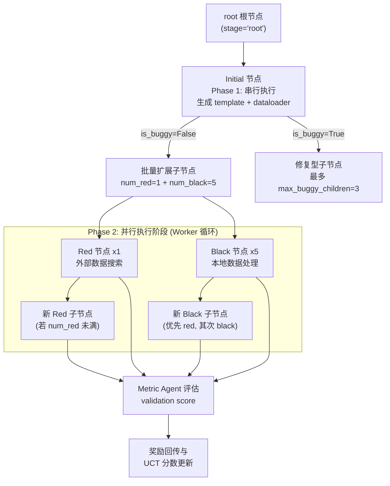

DataMaster 将"数据工程"这一复杂任务分解为三类职责截然不同的节点实验（Exp）：**Initial** 负责从零构建首份可提交方案，**Black** 专注于对本地已有数据做清洗与增强，**Red** 专注于从外部数据源搜索并引入新数据。三者在 UCT 搜索树中以 `stage` 字段区分（实际取值为 `root` / `initial` / `black` / `red`；`uct.py` 里的类型标注 `StageLiteral` 漏写了 `initial`，但代码里确实在用），各自绑定独立的 LLM Agent 配置与提示词体系，由 `DataTreePlayground` 统一调度。本文将从架构设计、职责边界、代码实现与调度分发四个层面，完整解析三类节点的职责划分逻辑。

Sources: [uct.py](playground/data_master/core/utils/uct.py#L1-L40)

> 📖 **小白导读**
> - 这篇讲什么：搜索树里有三种"节点"（一次尝试）：Initial 负责写出第一版完整代码，Black 在本地数据上做清洗和增强，Red 去网上找新的外部数据；本文解释它们各自管什么、怎么被调度。
> - 读之前先知道：**节点**（搜索树上的一次尝试，带代码和分数）；**template**（模板，这里指"算法与训练部分"的代码）；**dataloader**（数据加载器，负责读取并预处理数据、喂给训练代码的那部分代码）；**prompt**（发给 LLM 的提示词）；**metric**（评价指标，比如验证集分数）；**消融实验**（把某个组件关掉，看整体效果变差多少，以判断它有没有用）。
> - 读完能明白：为什么要把"数据工程"拆成这三种节点；每种节点代码上到底做了什么、不能做什么；每次最多会长出几个子节点；以及几处文档与代码不一致的地方。
> - 提醒：开源版只有 MLE-Bench（Kaggle）这一条流程；README 的 Roadmap 把 PostTrainBench 标为"Coming soon"。

## 设计哲学：将数据探索拆解为正交的职责轴

DataMaster 的前身是 ML-Master（一个通用 MCTS 代码优化智能体；这里 MCTS 指蒙特卡洛树搜索，把每次尝试当作树上的一个节点，用打分决定往哪个方向继续尝试），其改造核心思路是**保持 UCT 树结构与评测方式不变，但让树中每个节点承载不同的数据工程职责**。仓库的 README 对这一设计给出了明确定义：root 根节点负责从 initial code 开始生成最初版本的代码；black 黑色节点主要负责对现有训练数据进行数据增强与数据整合；red 红色节点主要负责通过调用外部搜索接口进行数据搜索、下载新的数据集到本地、引入新的数据源。

这一划分体现了一个关键的工程判断：**提升机器学习任务的性能有两条正交的路径**——一条是"深挖本地数据"（清洗、特征工程、增强合成），另一条是"扩大数据边界"（寻找外部公开数据集）。Black 与 Red 节点分别封装这两条路径，而 Initial 节点则为整棵搜索树提供共同的代码起点。每个节点无论类型，最终仍会提交一份完整代码进行评判，以 validation score（验证集分数，即不拿测试集、只用留出的验证数据算出的分数）作为统一评判标准，这使得三类节点能在同一 UCT 框架下公平竞争与回传奖励。（但要注意：下文会说明，Phase 2 实际是从一个堆里近似随机地取节点，所谓"竞争"主要体现在奖励回传，而不是出场顺序。）

Sources: [README.md](playground/data_master/README.md#L7-L56)

## 架构总览：三类节点在搜索树中的位置

在深入每个节点的实现前，先理解三类节点在 UCT 树与调度系统中的整体拓扑关系。下图展示了从根节点初始化、Initial 首次执行、到 Black/Red 子节点批量扩展的完整生命周期：



图中的 Phase 1 / Phase 2 是两个执行阶段：先由一个 Worker 串行跑完 Initial，再让多个 Worker 并行处理堆里的节点（详见上一篇）。图中关键的数量约束来自 `UCTSearchConfig`：`num_black = 5`（black 节点上限）、`num_red = 1`（red 节点上限），以及 `buggy_penalty = 1000.0`（buggy 节点的 UCT 惩罚值）。`is_fully_expanded` 方法则依据 stage 类型判断扩展是否完成——root 节点生成 initial 后不再扩展，black/red/initial 节点扩展到 `num_black + num_red`（即 6）个子节点即满，buggy 节点最多允许 3 个子节点尝试修复。这里的 `buggy` 指节点的代码运行失败或没有解析出分数（`is_bug = detail.is_bug or metric is None`，playground_helpers.py:63）。

Sources: [uct.py](playground/data_master/core/utils/uct.py#L111-L124) [uct.py](playground/data_master/core/utils/uct.py#L386-L410)

三类节点对应的实验类全部继承自统一基类 `NodeExp`（定义于 `exp/__init__.py`），该基类持有 UCT 节点对象 `node`、数据预览 `data_preview`、Metric Agent 引用与工作区路径，并实现了关键的 `_run_metric_agent` 方法——支持默认模式（解析验证集分数）与 test-feedback 模式（解析测试集分数）两种评估路径。默认模式下，metric agent 是一个只能调用 `finish` 的"解析员"：它读到代码和运行输出（stdout，即程序打印的文字），从中找出分数。test-feedback 模式在当前代码里并不可用：创建测试评分 agent 时 `system_prompt_file` 写的是字面量 `"${PROJECT_ROOT}/..."` 且没有传 `config_dir`，会抛 `ValueError`（playground.py:128-136）；而且该模式会把测试集分数带进搜索，相当于"偷看答案"。这一设计确保三类节点共享完全一致的评估闭环，职责差异仅体现在"如何生成代码"这一环节。

Sources: [__init__.py](playground/data_master/core/exp/__init__.py#L19-L95)

## Initial 节点：首份有效提交的构建者

`InitialExp` 是搜索树的起点，其系统提示词将其定位为"参加 Kaggle 竞赛的 grandmaster，需要提出优秀且有创意的解决方案计划并用 Python 实现"。与 Black/Red 节点不同，Initial 节点的 `run` 方法签名只需要 `task_description` 一个参数——它没有父节点代码可继承，一切从零开始。

### 四种启动模式

Initial 节点最显著的设计特征是支持**四种输入模式**，由 `_assemble_mode_specific_prompt` 函数根据 `initial_code` 与 `initial_instruction` 两个参数的有无自动选择对应的提示词模板：

| 模式 | initial_code | initial_instruction | 提示词模板 |
|------|:---:|:---:|------|
| 模式 1 | ✅ | ✅ | `mode_code_and_instruction.md` |
| 模式 2 | ✅ | ❌ | `mode_code_only.md` |
| 模式 3 | ❌ | ✅ | `mode_instruction_only.md` |
| 模式 4（自由模式） | ❌ | ❌ | `mode_free.md` |

这种设计使 DataMaster 能灵活适配不同竞赛的初始条件：有些 MLE-Bench 任务提供了 baseline 代码可直接复用（模式 2），有些只提供了自然语言指引（模式 3），而最开放的任务则完全交给 Agent 自由发挥（模式 4）。仓库的 `initial_code/data_loader_format/` 目录下为 22 个竞赛任务预置了初始代码（每个目录含 `algo.py`、`data_loader.py`、`full_code.py`），可以通过命令行参数 `--initial-code <文件路径>` 和 `--initial-instruction <文字>` 手动传入（run.py:83-91、486-503）；不传则自动进入自由模式。这些预置代码是否专为模式 2 服务，代码里没有明确声明（未验证）。

Sources: [initial_exp.py](playground/data_master/core/exp/initial_exp.py#L21-L67)

### 代码生成与组装流水线

Initial 节点执行时构造 `TaskInstance` 并显式标记 `task_type="initial"`，随后将组装好的提示词变量注入 Agent 的 `_prompt_format_kwargs`。Agent 被期望通过 `operate_submission_write_code` 等工具（MCP 提供的"写代码文件"工具，prompts/tools/operate/for_datanode.md:41）生成两个文件：`code_{node_id}_template.py`（算法计算部分，即训练模型的代码）与 `code_{node_id}_dataloader.py`（数据加载部分）。若 dataloader 文件缺失，代码会尝试从 Agent 最终回复中提取第一个 Python 代码块作为兜底；如果回复里一个代码块都没有，`extract_python_code` 会把整段回复原文当作代码写入（runtime.py:21-27），之后大概率运行失败并被判为 bug 节点。template 缺失只会记一条警告，后面 `_assemble_code` 会因找不到文件而返回 `None`（_submission_utils.py:724-732）。最后通过 `_assemble_code` 按 `base_dataloader + dataloader + template` 的顺序拼装完整代码，经 `run_code_via_bash` 执行后交由 `_run_metric_agent` 评估。**Initial 节点是唯一有权定义 template（算法部分）的节点类型**——这构成了后续 Black/Red 节点"算法不可变"约束的起点。

Sources: [initial_exp.py](playground/data_master/core/exp/initial_exp.py#L103-L227)

## Black 节点：本地数据处理专家

`BlackExp` 的系统提示词将其定位为"精通数据清洗、预处理与增强的 Kaggle grandmaster，可访问预写好的、经过实战检验的数据处理函数技能目录"。其类文档字符串列举了四大职责：数据清洗和预处理、特征工程（创建新特征、特征转换）、数据增强（SMOTE、噪声注入等）、特征选择和降维。

### 关键约束：template 不可变

Black 节点的 `run` 方法执行的第一步就是**从父节点复制 template**：读取 `code_{parent_id}_template.py` 并原样写入 `code_{node_id}_template.py`，若父模板不存在则直接返回错误。这一机制在提示词层面被进一步强化——用户提示词明确要求"Algorithm Computation Section 保持与父代码完全一致，你无权修改它"。换言之，**Black 节点只能修改 DataLoader 部分**，通过改进数据管线来提升固定算法的性能。需要注意的是，代码只复制了父节点的 template，**并没有复制父节点的 dataloader**（只有 `RuleBlackExp` 会复制）：父 dataloader 只是作为参考文本通过 `{parent_dataloader}` 放进提示词，Agent 必须自己重新写出完整的 `MyDataLoader`。"template 不可变"是靠代码复制加提示词要求共同保证的，而不是技术上禁止修改。这种"算法冻结、数据自由"的职责切分，使得搜索树的每一次分化都聚焦在数据维度上，避免 Agent 在算法调参上浪费探索预算。

Sources: [black_exp.py](playground/data_master/core/exp/black_exp.py#L90-L103) [user_prompt.md](playground/data_master/prompts/black/user_prompt.md#L88-L91)

### 输入上下文与工作流

与 Initial 节点不同，Black 节点的 `run` 方法接收完整的前序上下文：`prev_code`（父节点代码）、`memory`（历史尝试的记忆，防止重复无效方案）、`term_out`（父节点执行输出）、`best_code` 与 `best_metric`（全局最佳方案）。用户提示词为 Black 节点规划了明确的工作流优先级——将主要精力投入前 5 步（读取父代码与记忆、检查 data_links、检查本地数据格式、形成数据处理假设、批量生成衍生数据），且要求至少 30 步专注于数据预览、增强脚本构建与多源数据组合。**新生成的数据集必须保存到 `{workspace}/data_links` 目录**供其他节点复用，并通过 `memory_tree_add_new_data` 注册到全局数据索引（Memory Tree，用文件夹结构记录每个节点的尝试和数据；这些记忆需要 Agent 主动调用工具去读，不会自动塞进 prompt）。

Sources: [black_exp.py](playground/data_master/core/exp/black_exp.py#L57-L149) [user_prompt.md](playground/data_master/prompts/black/user_prompt.md#L56-L106)

## Red 节点：外部数据搜索专家

`RedExp` 的系统提示词定位其为"精通外部数据寻源与集成的 Kaggle grandmaster"，用户提示词则给出了更锐利的职责定义：**"你是数据搜索 Agent，而非通用编码 Agent"**。Red 节点被明确要求 "search-focused, not operate-focused"。

### 职责范围的重新定义

Red 节点最独特的设计在于其**成功标准与 Black 节点根本不同**。用户提示词的 "Important Change of Scope" 部分明确指出：Red 节点不需要将大部分精力用于形成最终的 DataLoader 提交，只要它完成了以下三件事就算成功——找到强力的新外部数据集、下载到正确位置、为后续节点清晰记录其格式/路径/集成建议。提示词甚至用负面清单进一步收窄职责边界：不要花大力气重写 DataLoader、不要陷入重复的 operate 循环、**不要表现得像专注于本地清洗的 Black 节点**、不要在 `{workspace}/data_links` 之外下载数据、不要引入泄漏风险、不要无理由下载大型低置信度数据集。

Sources: [red/system_prompt.md](playground/data_master/prompts/red/system_prompt.md#L1-L13) [user_prompt.md](playground/data_master/prompts/red/user_prompt.md#L14-L73)

### 与 Black 节点的实现差异

从代码结构看，`RedExp` 与 `BlackExp` 高度同构（同样复制父模板、同样组装运行、同样评估），仅有两处实质差异：其一，Red 节点额外加载 `search.md` 搜索工具手册并注入到提示词变量 `search_tools_manual` 中；其二，其 TaskInstance 标记为 `task_type="red"`（此外两者使用不同的提示词目录）。顺带一提，`red_exp.py:111` 的 `search_tool_manual.format(workspace=...)` 没有把结果赋回变量，所以这次格式化实际上没有生效。红节点允许只搜数据、不写 dataloader；这时如果 dataloader 文件不存在，兜底逻辑会把回复里的代码块（或整段回复）当作 dataloader，这一点与"不要花力气写 DataLoader"的提示词存在张力（推断）。搜索能力的差异**并不**体现在工具配置上：yaml 中 black 与 red 的 `mcp` 都是 `$mcp_data_node`（含 search_web、search_github、search_huggingface、search_scholar），而且 MCP 连接只初始化一次，initial、black、red 实际看到的是同一套完整工具，区分它们的只有提示词（black 的提示词引导它专注本地数据处理，red 的引导它搜索）。

Sources: [red_exp.py](playground/data_master/core/exp/red_exp.py#L80-L128) [base_datanode.json](configs/data_master/base_datanode.json#L1-L65)

## 三类节点的系统性对比

综合以上分析，三类节点在多个维度上形成了清晰的职责分工矩阵：

| 对比维度 | Initial | Black | Red |
|---------|---------|-------|-----|
| **核心职责** | 构建首份完整方案 | 本地数据清洗与增强 | 外部数据搜索与引入 |
| **stage 值** | initial（root 的子节点） | black | red |
| **父节点依赖** | 无（从零开始） | 复制父 template；父 dataloader 仅作参考，需自己重写 | 同 Black |
| **可修改范围** | template + dataloader | 仅 dataloader | 仅 dataloader（甚至可不做） |
| **run 方法签名** | `run(task_description)` | `run(task_description, prev_code, memory, term_out, best_code, best_metric)` | 同 Black |
| **成功标准** | 生成可执行提交 | validation score 提升 | 找到数据 + 正确存储 + 清晰记录 |
| **max_turns** | 20 | 50 | 50 |
| **专属工具手册** | `for_initial_exp_en.md` | `for_datanode_en.md` | `for_datanode_en.md` + `search.md` |
| **MCP 配置** | `$mcp_initial`（operate + memory） | `$mcp_data_node`（operate + memory + 搜索套件） | 同 Black（但实际上 MCP 只初始化一次，三者看到的是同一套工具，见上文） |
| **单父节点子数上限** | —（唯一 initial） | `num_black = 5` | `num_red = 1` |
| **提示词目录** | `prompts/initial/` | `prompts/black/` | `prompts/red/` |

值得注意的是**数量配比的深意**：每个非 buggy 父节点只允许 1 个 Red 子节点但允许 5 个 Black 子节点，这反映了外部数据引入是"低频高价值"操作（引入一次外部数据集后，后续大量 Black 节点可围绕该数据做深度加工），而本地数据处理则是需要反复迭代试错的高频操作（这是对设计意图的解读，代码和 README 只写了数量上限，没有解释原因，推断）。

Sources: [uct.py](playground/data_master/core/utils/uct.py#L111-L124) [config_base.yaml](configs/data_master/config_base.yaml#L49-L101)

Agent 配置层面，三类节点绑定不同的提示词文件与对话轮次上限。`config_base.yaml` 中 initial Agent 的 `max_turns=20`（一次成型），而 black/red Agent 的 `max_turns=50`（需要更多轮次进行数据处理或搜索迭代）。Metric Agent 则配置为 `max_turns=4` 且仅挂载 `finish` 工具，体现其"轻量解析器"的定位。

Sources: [config_base.yaml](configs/data_master/config_base.yaml#L49-L118)

## 调度分发机制：_run_one_node 的多态路由

三类节点的实例化与分发由 `DataTreePlayground._run_one_node` 方法完成，这是理解职责划分落地的关键代码。该方法根据传入的 `stage` 参数执行三路分支：

```python
if stage == "initial":
    exp = InitialExp(worker_agents["initial"], ..., 
                     initial_code=self.initial_code,
                     initial_instruction=self.initial_instruction)
    return exp.run(task_description)

if stage == "black":
    black_mode = getattr(self, "black_mode", "agent")
    exp_cls = RuleBlackExp if black_mode == "rule_based" else BlackExp
    exp = exp_cls(worker_agents["black"], ...)
    return exp.run(task_description, prev_code=prev_code, memory=memory, 
                   term_out=term_out, best_code=best_code, best_metric=best_metric)

if stage == "red":
    if not self.use_red_node:
        raise RuntimeError("Red node execution requested while use_red_node=False")
    exp = RedExp(worker_agents["red"], ...)
    return exp.run(...)  # 签名同 Black
```

这一分发逻辑揭示了三个重要机制：其一，**每个 Worker 拥有独立的 Agent 副本**（Worker 即并行干活的线程；通过 `_create_worker_agents` 调用 `copy_agent` 复制），避免并行执行时的对话状态污染（但默认配置下它们仍共用同一个 workspace 目录）；其二，Black 节点存在 `agent` 与 `rule_based` 两种模式，后者指向消融实验用的 `RuleBlackExp`；其三，Red 节点的执行受 `use_red_node` 开关保护，消融模式下若被错误调用会直接抛出异常。正常情况下，节点的执行结果统一返回 `{plan, code, raw_response, exec, metric, metric_detail}` 六字段结构（`plan` 在 Initial/Black/Red 里都是空字符串，只有 `RuleBlackExp` 填了一句说明），保证了下游评估与快照管线的一致性。若 stage 不是这三种（如 `terminal`），则返回一个 `TERMINATE` 占位的错误结果（playground.py:607-614）；Black/Red 找不到父 template 时只返回 `{"error": ...}`，随后同样被当成 bug 节点。

Sources: [playground.py](playground/data_master/core/playground.py#L502-L614)

## 节点扩展策略：两阶段调度与事件驱动分化

三类节点的创建时机由两阶段调度模型控制。**Phase 1 是串行的 Initial 阶段**：`_handle_phase1` 方法确保只有 worker 0 能执行 initial 节点（其余 worker 返回等待状态），initial 完成后由 `_batch_expand_after_initial` 一次性批量创建全部初始子节点——1 个 Red（若 `use_red_node=True`）加 5 个 Black，并将其压入执行队列（"堆"，一种按键值取最大/最小元素的数据结构）。**Phase 2 是并行执行阶段**：`_handle_phase2` 通过 `pop_execution_node` 从执行堆中取出节点分发给空闲 Worker。原文说"取出高价值节点"并不准确：堆键里的 UCT 值在入堆时只算一次，新节点 `visits=0` 时 UCT 为 `inf`，所有新节点的键都是 `(-inf, node.id)`，于是实际按随机的 `node.id` 出堆，既不是按价值也不是先进先出（uct.py:274-281）。

Sources: [playground.py](playground/data_master/core/playground.py#L765-L847)

在 Phase 2 中，每当一个节点执行完毕，`_expand_after_node_completion` 触发事件驱动扩展，包含两条路径：**扩展父节点（创建兄弟）**由 `_expand_parent_node` 处理，它会统计父节点现有 red/black 子节点数，将未达上限的 stage 加入候选列表后随机选择（两轮各创建一个兄弟节点）；**扩展当前节点（创建子节点）**由 `_expand_current_node` 处理，其优先级为 red 严格优先于 black——只有当 `num_red < search_cfg.num_red` 不满足时才考虑创建 black 子节点。这种"Red 优先"策略确保外部数据的引入机会不被本地数据处理的高频扩展所挤占。

Sources: [playground.py](playground/data_master/core/playground.py#L1027-L1120)

批量创建阶段的逻辑由 `_select_stages_batch` 统一实现，该方法同样遵循"先红后黑"的顺序：先检查 `use_red_node` 开关与 `num_red` 上限决定是否创建 red 子节点，再根据 `num_black` 与现有 black 子节点数之差循环追加 black 子节点。若目标节点是 buggy 的，并且它已有的子节点数达到 3（`max_buggy_children`），则直接返回 `terminal` 标记节点终止，防止无限生成失败变体；子节点数不足 3 时，buggy 节点依然会按同样规则补足 red/black 子节点（所以 initial 节点即使 buggy，也照样一次性长出 6 个子节点）。当没有任何可创建的 stage 时，同样返回 `terminal`。另外，即便关闭 `use_red_node`，每个节点仍最多有 5 个 black 子节点，树并不会变成二叉结构。

Sources: [playground.py](playground/data_master/core/playground.py#L446-L500)

## RuleBlackExp：职责划分的消融验证

`RuleBlackExp` 是 Black 节点的"无操作直通"变体，专用于**组件消融实验**。其文件头部注释清晰陈述了设计意图：保持 Black 节点在搜索树中的结构性存在，但移除其功能性的数据处理贡献。具体行为是——不调用 Black LLM Agent、不读取 Black 提示词、不生成新数据、不修改 data_links，仅原样复制父模板与父 DataLoader，组装运行继承的方案，再用普通 Metric Agent 评估。

这一变体通过 `black_mode` 配置项切换（`ablation` 配置段的 `black_mode: "rule_based"`；读取处见 playground.py:79-83，没有该段时默认红节点开启、`black_mode="agent"`）。需要注意：基础模板 `config_base.yaml:284-286` 的 `ablation` 段只有 `use_red_node` 与 `use_memory` 两个占位符，**没有** `black_mode`，仓库里已生成的各任务 yaml 也不含 `ablation` 段，想用 rule_based 必须手动在 yaml 里加；另外 `scripts/auto_config_exp.py` 渲染模板时没有传 `use_red_node`/`use_memory`，会抛 `KeyError`。使得研究者能够单独衡量"Black 节点的数据处理能力"对整体性能的贡献，而不破坏搜索树的拓扑结构与节点数量分布。与之配套的还有 `use_red_node` 开关（移除红节点）与 `use_memory` 开关（移除记忆树），三者共同构成 DataMaster 的消融实验体系。另外，仓库里 `prompts/rule_based_black/` 下的两个提示词文件从未被任何代码加载（`RuleBlackExp` 根本不调用 LLM），可以视为遗留文件。

Sources: [rule_black_exp.py](playground/data_master/core/exp/rule_black_exp.py#L1-L42) [playground.py](playground/data_master/core/playground.py#L79-L90)

## 关键文件索引

以下汇总了三类节点职责划分涉及的全部核心文件，便于二次开发时快速定位：

| 文件 | 职责 |
|------|------|
| [uct.py](playground/data_master/core/utils/uct.py#L320-L410) | `UCTNode` 定义 stage 字段；`is_fully_expanded` 控制扩展上限 |
| [uct.py](playground/data_master/core/utils/uct.py#L111-L124) | `UCTSearchConfig`：num_black=5、num_red=1、buggy_penalty |
| [__init__.py](playground/data_master/core/exp/__init__.py#L19-L95) | `NodeExp` 基类：metric 评估闭环、test-feedback 双模式 |
| [initial_exp.py](playground/data_master/core/exp/initial_exp.py#L70-L227) | `InitialExp`：四种模式、template+dataloader 生成 |
| [black_exp.py](playground/data_master/core/exp/black_exp.py#L21-L216) | `BlackExp`：复制父模板、仅改 DataLoader |
| [red_exp.py](playground/data_master/core/exp/red_exp.py#L21-L183) | `RedExp`：注入搜索工具手册、外部数据引入 |
| [rule_black_exp.py](playground/data_master/core/exp/rule_black_exp.py#L36-L183) | `RuleBlackExp`：no-op 直通消融变体 |
| [playground.py](playground/data_master/core/playground.py#L502-L614) | `_run_one_node`：三类节点的多态分发 |
| [playground.py](playground/data_master/core/playground.py#L765-L847) | Phase 1 串行 Initial + 批量扩展子节点 |
| [config_base.yaml](configs/data_master/config_base.yaml#L49-L118) | 三类 Agent 的 LLM/工具/提示词配置 |
| [base_datanode.json](configs/data_master/base_datanode.json#L1-L65) | Black/Red 节点的 MCP 服务器配置（含搜索套件） |

理解三类节点的职责划分后，可以进一步阅读 [UCT 搜索算法：节点选择、奖励更新与衰减策略](9-uct-sou-suo-suan-fa-jie-dian-xuan-ze-jiang-li-geng-xin-yu-shuai-jian-ce-lue) 了解节点如何基于 UCT 值竞争执行优先级，或阅读 [组件消融实验：use_red_node / use_memory / black_mode 开关](29-zu-jian-xiao-rong-shi-yan-use_red_node-use_memory-black_mode-kai-guan) 了解如何通过开关验证各节点类型的实际贡献。若需理解 Black/Red 节点生成数据后的存储与复用机制，可参阅 [Memory Tree：与 UCT 树对应的文件系统设计](12-memory-tree-yu-uct-shu-dui-ying-de-wen-jian-xi-tong-she-ji) 与 [Data Pool 与外部数据源引入（红节点数据下载）](14-data-pool-yu-wai-bu-shu-ju-yuan-yin-ru-hong-jie-dian-shu-ju-xia-zai)。

## 本文修订记录

- 原文说 Phase 2 从 UCT 最大堆取"高价值节点"；实际堆键的 UCT 值入堆时算一次且新节点为 `inf`，等价于按随机 id 出堆（uct.py:274-281）。已改正。
- 原文说 Black/Red"只能修改 dataloader"并暗示继承父 dataloader；实际只复制 template，dataloader 需 Agent 从零重写（仅 `RuleBlackExp` 复制，black_exp.py:90-103、rule_black_exp.py:136-142）。已改正并补充 dataloader 缺失时的兜底会把整段回复当代码。
- 原文说 Red 与 Black 的搜索能力差异体现在 MCP 配置；实际两者都用 `$mcp_data_node`，且 MCP 只初始化一次，initial/black/red 看到同一套工具，只靠 prompt 区分。已改正。
- 原文说 buggy 节点的子节点上限"收紧为 3"；实际只有已有子节点数达到 3 时才返回 `terminal`，否则仍补足 red/black（`_select_stages_batch`，playground.py:453-463）。已改正；补充关闭红节点后仍最多 5 个 black 子节点。
- 补充消融配置的真实情况：`black_mode` 不在 `config_base.yaml` 模板里，已生成 yaml 无 `ablation` 段，`auto_config_exp.py` 会因缺 `use_red_node`/`use_memory` 抛 `KeyError`；`rule_based_black` 提示词从未被加载；test-feedback 模式因 `${PROJECT_ROOT}` 字面量会抛 `ValueError`。
- 补充 `initial_code` 需通过 `--initial-code` 手动传入、`stage` 实际含 `initial`、`plan` 恒为空、`red_exp.py:111` 的 `format` 结果未被使用。
- 补充小白导读与术语解释；"低频高价值"的设计动机解读已标（推断）。