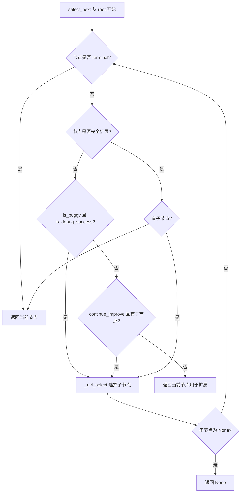
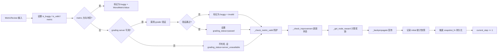
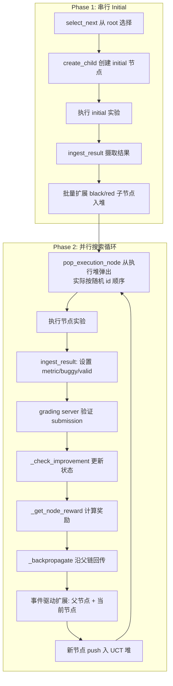

DataMaster 的搜索核心是一套基于 **UCT（Upper Confidence Bound for Trees，树的置信上界：一个给"候选节点"打分的公式，用来在"再试试没怎么试过的方向"和"继续挖已知效果好的方向"之间做权衡）** 的蒙特卡洛树搜索（MCTS：把每次尝试组织成一棵树，反复"选一个节点→尝试→打分→把分数传回祖先"的搜索方法）算法。与经典 MCTS 的四阶段（选择→扩展→模拟→回传）不同，DataMaster 的 UCT 搜索将"模拟"替换为真实的 LLM（大语言模型）驱动代码生成与执行，将"扩展"改造为面向数据工程的三色节点体系（Initial/Black/Red），同时在节点选择、奖励计算和探索系数衰减三个维度上引入了精细化的工程设计。本文档将深入解析 `UCTSearchManager` 的完整算法链路：从树节点的数据结构定义，到 UCT 值的计算公式，再到五种衰减策略的数学形式，最后回到 Playground（`DataTreePlayground`，负责跑完整个搜索流程的主类）中并行执行循环如何消费这些 UCT 决策。

Sources: [uct.py](playground/data_master/core/utils/uct.py#L1-L25)

> 📖 **小白导读**
> - **这篇讲什么**：DataMaster 怎么用一棵"尝试树"来决定下一步试哪个方案，包括节点怎么打分（UCT 公式）、结果怎么给奖励并传回祖先、探索系数 `c` 怎么随时间变化，以及执行队列（堆）怎么取节点。
> - **读之前先知道**：①树的"父节点/子节点"；②"buggy 节点"指代码跑出错或结果被判无效的节点；③"堆"是一种容器，每次能快速取出键最小（或最大）的元素；④节点分 initial / black / red 三种（详见第 8 篇）。
> - **读完能明白**：UCT 公式每一项的含义；奖励怎么算；`c` 的衰减在默认配置下实际取什么值。
> - **重要提醒**：本文已按代码核对修正。按开源版代码推演，UCT 打分在 phase 2（并行阶段）并不决定执行顺序，`c` 的衰减在默认配置下也几乎是常数，详见相应小节。

## UCT 树节点数据结构：UCTNode

UCT 搜索树的每个节点由 `UCTNode` 数据类表示，它是整个算法的状态载体。节点持有四类信息：**树拓扑**（parent/children/expected_child_count）、**执行结果**（metric/is_buggy/is_valid/grading_status）、**搜索统计**（visits/total_reward）和**控制标志**（is_terminal/locked/continue_improve）。

```python
@dataclass(eq=False)
class UCTNode:
    stage: StageLiteral          # "root" | "black" | "red"（实际还有 "initial"）
    plan: str = ""
    code: str = ""
    parent: Optional["UCTNode"] = None
    id: str = field(default_factory=lambda: uuid.uuid4().hex)
    metric: MetricValue = field(default_factory=WorstMetricValue)
    is_buggy: Optional[bool] = None
    is_terminal: bool = False
    visits: int = 0
    total_reward: float = 0.0
    children: set["UCTNode"] = field(default_factory=set)
    expected_child_count: int = 0
    locked: bool = False
    continue_improve: bool = False
```

其中 `expected_child_count` 与 `children` 的分离设计是并行搜索的关键——在多 Worker（并行干活的线程，可以理解为同时开几个"工人"）环境下，子节点被创建但尚未完成执行时，`expected_child_count` 已递增而 `children` 集合尚未填充，`is_fully_expanded()` 方法通过 `expected_child_count` 判断来避免重复扩展。

Sources: [uct.py](playground/data_master/core/utils/uct.py#L320-L410)

### 节点完全扩展判定

`is_fully_expanded()` 方法根据节点类型应用不同的扩展上限策略：

| 节点类型 | 扩展上限 | 判定逻辑 |
|---------|---------|---------|
| root | 1 | 仅生成一个 initial 子节点 |
| buggy 节点 | 3 | 限制修复尝试次数，防止无限生成失败变体 |
| black/red/initial | `num_black + num_red` | 默认 5+1=6 个子节点（可含 black 与 red） |

值得注意的是，**buggy 节点不会被硬性阻止扩展**（最多 3 个子节点用于尝试修复）。选择时 `_uct_select` 先看非 buggy 的子节点，只有没有非 buggy 子节点时才回退到可扩展的 buggy 节点（见下文）；UCT 公式里的惩罚项只对"已经访问过"的 buggy 节点起作用。这一设计与 ML-Master 基线中 buggy 节点在获得非 buggy 子节点后立即停止扩展的策略形成对比——DataMaster 允许 buggy 节点继续尝试修复，最多 3 次。

Sources: [uct.py](playground/data_master/core/utils/uct.py#L386-L410), [mcts_node.py](playground/ml_master/core/mcts_node.py#L78-L101)

## UCT 值计算：exploitation + exploration - penalty

UCT 值是节点选择的核心决策依据。DataMaster 的 `uct_value()` 方法实现了带 buggy 惩罚的 UCT 公式：

```python
def uct_value(self, exploration_constant, parent_visits, buggy_penalty=None, search_cfg=None):
    if buggy_penalty is None:
        if self.is_buggy and search_cfg is not None:
            buggy_penalty = search_cfg.buggy_penalty  # 默认 1000.0
        else:
            buggy_penalty = 0.0

    if self.visits == 0:
        base_value = float("inf")
        return base_value - buggy_penalty if self.is_buggy else base_value

    parent_total = max(parent_visits, 1)
    exploitation = self.total_reward / self.visits
    exploration = exploration_constant * math.sqrt(math.log(parent_total) / self.visits)
    uct = exploitation + exploration
    return uct - buggy_penalty if self.is_buggy else uct
```

**公式分解**：

$$UCT = \underbrace{\frac{R_{total}}{n_{visits}}}_{\text{exploitation}} + \underbrace{c \cdot \sqrt{\frac{\ln(N_{parent})}{n_{visits}}}}_{\text{exploration}} - \underbrace{P_{buggy}}_{\text{penalty}}$$

三个分量的工程含义：

- **exploitation**（利用项）：平均奖励 `total_reward / visits`，反映节点的历史表现质量
- **exploration**（探索项）：`c × √(ln(N_parent) / n_visits)`，经典 UCB1 探索_bonus，访问次数少的节点获得更高探索加权
- **penalty**（惩罚项）：buggy 节点减去 `buggy_penalty`（默认 1000.0），使**已访问过**的 buggy 节点的 UCT 值远低于正常节点

未访问节点（`visits == 0`）返回 `float("inf")`（正无穷）。代码里对 buggy 的未访问节点写的是 `inf - 1000`，但**无穷大减去任何有限数仍然是无穷大**（`inf - 1000 == inf`），所以这个惩罚在此分支里完全无效：未访问的节点，无论是否 buggy，UCT 值都是 `inf`，buggy 新节点并不会因此排在非 buggy 节点之后。好在这个分支实际几乎走不到：一个节点只有执行完成并回传（`visits` 至少为 1）之后才会被标记为 buggy，而新建节点的 `is_buggy` 是 `None`（推断，依据 `ingest_result` 与 `_backpropagate` 的调用顺序）。

Sources: [uct.py](playground/data_master/core/utils/uct.py#L415-L445)

### DataMaster 与 ML-Master 的 UCT 公式对比

| 特征 | DataMaster UCTNode | ML-Master MCTSNode |
|------|-------------------|-------------------|
| 探索项公式 | `c × √(ln(N) / n)` | `c × √(ln(max(1, N)) / n)` |
| buggy 惩罚 | 显式减去 `buggy_penalty`（1000.0） | 无显式惩罚，依赖 buggy 节点 reward=-1 |
| 未访问节点 | `inf`（非 buggy）或 `inf - penalty`（buggy；数学上仍是 `inf`，惩罚无效） | `inf`（所有未访问节点） |
| 父节点访问次数 | 从外部传入 `parent_visits` | 直接读取 `self.parent.visits` |
| 探索系数 | 通过 `_exploration_constant()` 动态衰减 | 通过 `get_C()` 动态衰减 |

DataMaster 的显式 buggy 惩罚机制是其与 ML-Master 基线的核心架构差异之一——ML-Master 依赖 reward 值（buggy=-1）间接影响 exploitation 项，而 DataMaster 直接在 UCT 值层面施加惩罚，使 buggy 节点在 UCT 排序中被更果断地降级。

Sources: [uct.py](playground/data_master/core/utils/uct.py#L415-L445), [mcts_node.py](playground/ml_master/core/mcts_node.py#L51-L76)

## 节点选择：select_next 与 _uct_select

### select_next：自顶向下的树遍历

`select_next()` 是节点选择的入口，从 root 开始自顶向下遍历搜索树，直到找到一个可扩展的节点或返回 None。**注意：在整个 DataMaster 代码里，它只在 Playground 的 phase 1（initial 阶段）被调用一次或几次（`playground.py` 第 775 行 `_handle_phase1`）；phase 2 的并行阶段不再调用它**，而是直接从执行堆里取节点（见下文）。其核心逻辑遵循以下决策树：



选择逻辑的关键分支：

1. **未完全扩展 + 无特殊条件** → 直接返回当前节点进行扩展（最常见的路径）
2. **未完全扩展 + buggy 且 debug 成功** → 向下选择子节点（已被修复的 buggy 节点继续深入）
3. **未完全扩展 + continue_improve** → 向下选择子节点（成功节点继续改进路径）
4. **完全扩展** → 必然向下选择子节点，通过 `_uct_select` 选择 UCT 值最高的子节点

Sources: [uct.py](playground/data_master/core/utils/uct.py#L597-L644)

### _uct_select：子节点 UCT 排序与 fallback 策略

`_uct_select()` 负责从父节点的子节点集合中选择 UCT 值最高的节点。它实现了两级 fallback 机制：

**第一级：优先选择非 buggy 且非 terminal 的子节点**
```python
available = [
    child for child in node.children
    if child.is_buggy is not None    # 已完成执行
    and not child.is_terminal         # 未终止
    and child.is_buggy is False       # 非 buggy
]
picked = max(available, key=lambda child: child.uct_value(c_val, node.visits, search_cfg=self.search_cfg))
```

**第二级：如果没有非 buggy 子节点，尝试选择可扩展的 buggy 子节点**
```python
buggy_available = [
    child for child in node.children
    if child.is_buggy is True
    and not child.is_terminal
    and child.num_children < (self.search_cfg.num_black + self.search_cfg.num_red)
]
picked = max(buggy_available, key=lambda child: child.uct_value(c_val, node.visits, search_cfg=self.search_cfg))
```

对于 root 节点，还有额外的 **锁定机制**：被选中的 initial 子节点会被 `locked = True` 标记，防止多个 Worker 同时选中同一个 initial 节点（不过 phase 1 里只有 Worker 0 在选，这个锁在开源版实际流程中作用有限，推断）。这一设计在 ML-Master 中同样存在（draft 节点的 lock）。

Sources: [uct.py](playground/data_master/core/utils/uct.py#L965-L1048), [mcts_agent.py](playground/ml_master/core/mcts_agent.py#L747-L768)

## 奖励计算与回传

### _get_node_reward：三因子奖励模型

DataMaster 的奖励计算不是简单的"越好越高"，而是一个三因子叠加模型：

```python
def _get_node_reward(self, node: UCTNode) -> float:
    if node.is_buggy or node.metric.value is None:
        return -1.0          # 因子 0：buggy 惩罚

    reward = 1.0              # 因子 1：基础成功奖励
    parent = node.parent
    if parent and parent.is_buggy:
        reward += 1.0          # 因子 2：修复 buggy 父节点的额外奖励

    if self.best_node and ... and improvement > 0:
        reward += 1.0          # 因子 3：超越当前最佳的额外奖励

    return reward
```

| 奖励因子 | 触发条件 | 奖励值 | 设计意图 |
|---------|---------|--------|---------|
| buggy 惩罚 | `is_buggy=True` 或 metric 缺失 | -1.0 | 抑制失败路径的探索 |
| 基础成功 | 非 buggy 且有有效 metric | +1.0 | 鼓励生成有效解决方案 |
| 修复奖励 | 父节点为 buggy 且当前节点成功 | +1.0 | 鼓励从失败中恢复 |
| 改进奖励 | metric 超越全局最佳 | +1.0 | 引导向更优解收敛 |

奖励的取值范围为 `[-1, 3]`，其中 `exploitation = total_reward / visits` 会将多次访问的累积奖励平均化，使得频繁被选中但表现平庸的节点逐渐被淘汰。

Sources: [uct.py](playground/data_master/core/utils/uct.py#L871-L904)

### _backpropagate：沿父链回传

回传逻辑简单而精确——从当前节点开始，沿 `parent` 指针逐层向上，对每个祖先节点调用 `update_reward(reward)`：

```python
def _backpropagate(self, node: UCTNode, reward: float) -> None:
    current = node
    while current is not None:
        if current.stage == "initial" and current.locked:
            current.locked = False    # 回传时解锁 initial 节点
        current.update_reward(reward)
        current = current.parent
```

`update_reward` 的实现是增量式的：`visits += 1; total_reward += reward`。这意味着同一次执行的结果会影响路径上所有祖先节点的统计量，这与标准 MCTS 的回传语义一致。

回传过程中还有一个重要的副作用：**initial 节点的锁定状态在首次回传时被解除**。这保证了 initial 节点在完成首次执行后可以被后续的 `select_next` 重新选中（如果其 UCT 值仍然具有竞争力）。

Sources: [uct.py](playground/data_master/core/utils/uct.py#L862-L869)

### ingest_result：结果摄取的完整流水线

`ingest_result()` 是连接执行结果与 UCT 更新的核心方法，它完成从 `MetricReview` 到 reward 回传的全流程：



这个流水线中有两个关键的工程决策：

**决策一：`ingest_result` 本身只信 `review.is_bug`，但上游已把"metric 缺失"算进了 bug。** 代码注释标注"核心修复 1"：`ingest_result` 里 `node.is_buggy = review.is_bug`，metric 缺失时只赋 `WorstMetricValue`（"最差值"占位对象）并在 analysis 里追加 `[metric] metric missing`，不再额外硬判死。**但是**，构造 `review` 的 `build_review`（`playground_helpers.py`）已经写了 `is_bug = detail.get("is_bug", False) or metric is None`，所以实际流程中 metric 缺失仍然等于 buggy。与 ML-Master 的差别主要在于：DataMaster 不看有没有 submission 文件（`has_submission` 只写进 analysis 提示），而 ML-Master 的判定还包含"没有 submission 即 buggy"。

**决策二：grading server 不可用不等于 buggy。** 代码注释标注"核心修复 2"——当 grader 调用失败时，`is_valid` 设为 `None`（未知），而非 `False`。只有 grader 明确返回 `is_valid=False` 才将节点标记为 buggy。这一设计避免了因基础设施故障导致的误判。

Sources: [uct.py](playground/data_master/core/utils/uct.py#L646-L851), [mcts_agent.py](playground/ml_master/core/mcts_agent.py#L480-L485)

## 探索系数衰减策略

### UCTDecayConfig：五种衰减模式

探索系数 `c` 的衰减控制着 exploitation 与 exploration 之间的动态平衡。DataMaster 提供了五种衰减策略，通过 `UCTDecayConfig` 配置：

| 衰减类型 | 公式 | 关键参数 | 适用场景 |
|---------|------|---------|---------|
| constant | `c = initial_c` | 无 | 固定探索强度，适合短搜索 |
| linear | `c = max(initial_c - α·t, lower_bound)` | `linear_alpha=0.01` | 均匀衰减，简单可预测 |
| exponential | `c = max(initial_c · γ^t, lower_bound)` | `exponential_gamma=0.99` | 早期快速衰减，后期缓慢 |
| piecewise | 三段分段函数 | `piecewise_phase_ratios=(0.3, 0.7)` | 精确控制各阶段探索强度 |
| dynamic_piecewise | 基于时间/进度估算的分段 | `dynamic_phase_ratios=(0.85, 1.0)` | 自适应实际搜索速度 |

**默认配置**为 `piecewise` 衰减，初始探索系数 `1.414`（即 √2），下限 `0.5`。Playground 创建管理器时直接写 `UCTDecayConfig()`（`playground.py` 约第 626-680 行），没有读取 yaml 里的任何衰减参数，所以这些数值在不改代码时无法通过配置文件修改。

Sources: [uct.py](playground/data_master/core/utils/uct.py#L127-L151)

### 分段衰减（piecewise）的数学形式

分段衰减将搜索过程分为三个阶段，由 `piecewise_phase_ratios` 控制分界点：

```
阶段 1 [0, t1):     c = initial_c          （保持初始探索强度）
阶段 2 [t1, t2]:    c = max(initial_c - α·(t-t1), lower_bound)  （线性衰减）
阶段 3 (t2, ∞):     c = lower_bound        （固定在下限）
```

其中 `t1 = round(0.3 × max(current_step, 1))`，`t2 = round(0.7 × max(current_step, 1))`。这意味着衰减的分界点随当前步数动态调整——这是一个值得注意的设计选择，因为标准 piecewise 衰减通常使用固定的 `t1` 和 `t2`（基于总步数），而 DataMaster 使用当前步数作为基准。（`round` 是四舍五入取整。）

```python
def _piecewise_decay(t, initial_c, t1, t2, alpha, lower_bound):
    if t < t1:
        return initial_c
    if t <= t2:
        return max(initial_c - alpha * (t - t1), lower_bound)
    return lower_bound
```

Sources: [uct.py](playground/data_master/core/utils/uct.py#L183-L207)

#### 按代码手算：默认配置下 c 到底取多少

默认参数：`initial_c = 1.414`，`alpha = 0.01`，`lower_bound = 0.5`。关键点是：传给 `_piecewise_decay` 的 `t` 就是 `current_step`，而 `t1`、`t2` 也是用同一个 `current_step` 乘 0.3、0.7 算出来的，所以 `t` 总是追着 `t2` 跑，而且很快就超过它。手算结果（已用独立脚本核对）如下：

| 当前步数 t | t1 = round(0.3·max(t,1)) | t2 = round(0.7·max(t,1)) | 落在哪一段 | c |
|---|---|---|---|---|
| 0 | 0 | 1 | t1 ≤ t ≤ t2，衰减 0 步 | 1.414 |
| 1 | 0 | 1 | t1 ≤ t ≤ t2，衰减 1 步 | 1.414 - 0.01×1 = 1.404 |
| 2 | 1 | 1 | t > t2 | 0.5 |
| 10 | 3 | 7 | t > t2 | 0.5 |
| 45 | 14 | 31 | t > t2 | 0.5 |
| 150 | 45 | 105 | t > t2 | 0.5 |

**为什么基本是常数**：从 `t = 2` 起，`0.7·t` 四舍五入后总小于 `t`（我对 2 到 1999 逐个核对过，没有例外），所以永远落在"阶段 3"，`c` 固定等于下限 0.5。只有 `t = 0` 和 `t = 1` 两步 `c` 约为 1.41，之后一直是 0.5。换句话说，"先大范围探索、后期再收敛"的衰减设计在这里**没有生效**：常规的 piecewise 应该用总步数（如 150）来定 `t1`、`t2`，这里误用了当前步数。

**这个 c 又用在哪**：`c` 只出现在 UCT 的探索项里，而探索项只对 `visits > 0` 的节点计算。按前面核对的调用关系，`select_next / _uct_select` 只在 phase 1 被调用，那时树里只有 root 和 initial 节点；phase 2 的执行堆里全是 `visits == 0` 的新节点，直接得到 `inf`，不用 `c`。所以在开源版实际流程中，`c` 对搜索行为几乎没有影响，它主要出现在日志与节点快照的 `uct_value` 字段里（推断）。

### 动态分段衰减（dynamic_piecewise）

动态分段衰减是五种策略中最复杂的，它根据实际搜索进度（而非固定步数）来估算衰减位置：

```python
def _dynamic_piecewise_decay(steps_limit, n_nodes, initial_c, start_time,
                              time_limit, alpha, lower_bound, phase_ratios):
    now = time.time()
    elapsed = now - start_time
    remaining = max(time_limit - elapsed, 1e-5)

    speed = n_nodes / elapsed if elapsed > 0 else 1.0
    n_remaining = round(speed * remaining)
    estimated_total = min(n_nodes + n_remaining, steps_limit)
    progress = n_nodes / estimated_total if estimated_total > 0 else 0.0

    p1, p2 = phase_ratios           # 默认 (0.85, 1.0)
    if progress < p1:
        return initial_c
    if progress < p2:
        decay_length = p2 - p1
        decay_progress = (progress - p1) / decay_length if decay_length > 0 else 0
        c_val = initial_c - alpha * decay_progress * estimated_total
        return max(c_val, lower_bound)
    return lower_bound
```

其核心思想是：通过当前节点生成速度 `speed = n_nodes / elapsed` 估算剩余可生成节点数 `n_remaining`，进而估算总节点数 `estimated_total`，最终计算进度比例 `progress = n_nodes / estimated_total`。这使得衰减曲线能自适应实际搜索速度——如果搜索比预期慢，衰减会更晚开始；如果搜索很快，衰减会更早触发。

默认的 `dynamic_phase_ratios = (0.85, 1.0)` 意味着：搜索进度的前 85% 保持初始探索强度，最后 15% 才开始衰减。这是一个高度 exploitation-first 的配置，与 piecewise 默认的 (0.3, 0.7) 形成对比。

不过 `_exploration_constant()` 在调用它时传的是 `steps_limit=max(self.current_step, 1)`、`time_limit=self.time_limit or 1e6`（而 `_create_search_manager` 没有传 `time_limit`，默认 0），所以 `estimated_total = min(n_nodes + n_remaining, steps_limit)` 最大就是当前步数，`progress` 当 `current_step ≥ 1` 时恒为 1.0，直接得到下限 0.5（按代码手工推演，推断）。这种模式不是默认模式，上面"自适应实际搜索速度"只是函数的设计意图。

Sources: [uct.py](playground/data_master/core/utils/uct.py#L210-L251)

### _exploration_constant：衰减调度入口

`_exploration_constant()` 是所有衰减策略的统一调度入口，在每次 UCT 值计算时被调用：

```python
def _exploration_constant(self) -> float:
    cfg = self.decay_cfg
    t = self.current_step
    if cfg.decay_type == "linear":
        c_val = _linear_decay(t, cfg.exploration_constant, cfg.linear_alpha, cfg.lower_bound)
    elif cfg.decay_type == "exponential":
        c_val = _exponential_decay(t, cfg.exploration_constant, cfg.exponential_gamma, cfg.lower_bound)
    elif cfg.decay_type == "piecewise":
        t1 = round(cfg.piecewise_phase_ratios[0] * max(self.current_step, 1))
        t2 = round(cfg.piecewise_phase_ratios[1] * max(self.current_step, 1))
        c_val = _piecewise_decay(t, cfg.exploration_constant, t1, t2, cfg.piecewise_alpha, cfg.lower_bound)
    elif cfg.decay_type == "dynamic_piecewise":
        c_val = _dynamic_piecewise_decay(...)
    else:
        c_val = cfg.exploration_constant  # constant
    return c_val
```

注意 `piecewise` 分支中 `t1` 和 `t2` 的计算使用了 `max(self.current_step, 1)` 而非总步数上限（`max_steps`），分界点随搜索推进而同步扩大。原文曾认为"step=10 时 t1=3、t2=7，衰减会过早开始"；更准确的说法是：因为 `t` 本身就是 `current_step`，`t` 恒大于 `t2`（从 `t = 2` 起），`c` 实际一直是下限 0.5，具体取值见上面的手算表。ML-Master 基线中的实现使用 `self.cfg.steps`（总步数上限）来计算 `T1` 和 `T2`，这才是真正的"按总进度分段"，更稳健。

Sources: [uct.py](playground/data_master/core/utils/uct.py#L1050-L1089), [mcts_agent.py](playground/ml_master/core/mcts_agent.py#L679-L691)

## UCTMaxHeap：并行执行优先队列

DataMaster 引入了 ML-Master 中没有的 `UCTMaxHeap` 数据结构（"最大堆"：一个每次都能快速取出键最大元素的待办队列），设计意图是在并行搜索中按 UCT 值优先调度节点执行（类注释写的是"用于按 UCT 值优先执行节点"）。**但实际效果与设计意图不符**，见下文分析：

```python
class UCTMaxHeap:
    def __init__(self, uct_func: Callable[[UCTNode], float]):
        self.uct_func = uct_func
        self.heap = []           # Python heapq 是最小堆，存储负值实现最大堆
        self.nodes = {}          # node_id -> node 映射，用于去重
        self.lock = threading.Lock()

    def push(self, node: UCTNode) -> None:
        with self.lock:
            if node.id in self.nodes:
                return            # 节点已存在，不重复入堆
            uct_value = self.uct_func(node)
            heapq.heappush(self.heap, (-uct_value, node.id))
            self.nodes[node.id] = node

    def pop_max(self) -> Optional[UCTNode]:
        with self.lock:
            if not self.heap:
                return None
            neg_uct, node_id = heapq.heappop(self.heap)
            return self.nodes.pop(node_id)
```

这个最大堆在 `UCTSearchManager.__init__` 中被实例化，使用 `_get_node_uct_value` 作为排序函数。在 Playground 的并行搜索循环中，Phase 2 阶段的 Worker 通过 `pop_execution_node()` 从堆中弹出一个节点来执行。

**实际出堆顺序并不是"UCT 值最高的先出"，而是随机顺序**，推理链如下（均来自代码）：

1. 入堆的键是 `(-uct_value, node.id)`，`uct_value` 在 `push` 的那一刻算一次（`uct.py` 第 274-281 行），之后不再更新。
2. 所有进堆的节点都是刚创建的，`visits == 0`，所以 `uct_value` 都是 `inf`，键都是 `(-inf, node.id)`。
3. `-inf` 彼此相等，Python 的 `heapq` 就会比较元组的第二项 `node.id`；`id` 是 `uuid.uuid4().hex`（随机十六进制字符串），字典序最小的先出。所以出堆顺序等价于随机，既不是按 UCT 优先级，也不是先进先出。

所以更准确地说：执行堆在开源版里只是一个线程安全的"待办节点池"，UCT 公式对 phase 2 的执行顺序没有影响。堆的线程安全通过 `threading.Lock`（线程锁：同一时刻只允许一个线程进入被保护的代码）保证，使得多个 Worker 可以并发地取任务。

Sources: [uct.py](playground/data_master/core/utils/uct.py#L261-L314), [uct.py](playground/data_master/core/utils/uct.py#L525-L542)

## 指标方向与 metric 有效性防护

### MetricValue：方向感知的比较

`MetricValue` 包装了原始指标值并携带 `maximize` 方向信息，其 `__gt__` 实现了方向感知的比较：

```python
def __gt__(self, other: "MetricValue") -> bool:
    if self.value is None:
        return False               # None 永远不大于任何值
    if other.value is None:
        return True                # 非 None 大于 None
    if self.value == other.value:
        return False
    comp = self.value > other.value
    return comp if self.maximize else not comp
```

这一设计使得同一个 UCT 搜索树可以处理"越大越好"（如 accuracy）和"越小越好"（如 RMSE）两种指标，而无需在搜索逻辑中添加方向判断分支。`WorstMetricValue` 作为 `MetricValue` 的子类，将 `value=None`，确保任何有效指标都优于它。

Sources: [uct.py](playground/data_master/core/utils/uct.py#L77-L103)

### _check_metric_valid：异常指标防护

`_check_metric_valid()` 防止因 parser 错误或代码 bug 导致的异常指标值污染搜索状态：

```python
def _check_metric_valid(self, node: UCTNode, upper_bound: int | None = None) -> bool:
    bound = upper_bound or getattr(self.search_cfg, "invalid_metric_upper_bound", 100)
    v1 = self.best_metric
    v2 = node.metric.value
    if v1 is None or v2 is None:
        return True
    if v1 == 0 or v2 == 0:
        return abs(v1 - v2) <= bound
    ratio = max(abs(v1), abs(v2)) / min(abs(v1), abs(v2))
    return ratio <= bound
```

当新指标与当前最佳指标的比值超过 `invalid_metric_upper_bound`（默认 100）时，指标被认为无效，节点被标记为 buggy。注意其中有一个特殊分支：只要新旧指标有一个恰好等于 0，就改为比较差值 `abs(v1 - v2) <= 100`，此时 0 分很容易被当成"有效"（详见[评估反馈闭环](11-ping-gu-fan-kui-bi-huan-metric-agent-yu-yan-zheng-zhi-biao-jie-xi)一篇）。这一防护在 `ingest_result` 中的两个位置被调用：一是在更新 best_node 之前（防止异常指标成为 best），二是在 metric 合法性检查中（将异常指标节点标记为 buggy）。

Sources: [uct.py](playground/data_master/core/utils/uct.py#L906-L916), [uct.py](playground/data_master/core/utils/uct.py#L793-L800)

### 指标方向冲突检测

`ingest_result` 中还有一个独特的**方向冲突检测**逻辑——如果新节点的 metric 方向（maximize/minimize）与当前 best_node 不一致，节点会被直接标记为 buggy：

```python
if (
    node.is_buggy is False
    and review.metric is not None
    and self.best_node
    and self.best_node.metric
    and node.metric.maximize != self.best_node.metric.maximize
):
    node.metric = WorstMetricValue()
    node.is_buggy = True
    node.is_valid = False
```

这一设计防止了同一搜索树中混合不同评估方向（如某个节点报告 accuracy，另一个报告 loss）导致的 best_node 误判。

Sources: [uct.py](playground/data_master/core/utils/uct.py#L696-L712)

## _check_improvement：改进追踪与终止控制

`_check_improvement()` 方法负责评估节点是否带来了实质性改进，并设置 `continue_improve` 和 `is_terminal` 标志：

```python
def _check_improvement(self, node: UCTNode) -> None:
    parent = node.parent
    local_best = node.local_best_node or (parent.local_best_node if parent else None) or parent
    scfg = self.search_cfg

    if node.is_buggy is False:
        new_metric = node.metric.value
        if parent and parent.is_buggy:
            node.continue_improve = False
            node.is_terminal = False
            return

        if new_metric is not None and local_best and local_best.metric.value is not None:
            improvement = (new_metric - local_best.metric.value
                          if node.metric.maximize
                          else local_best.metric.value - new_metric)
            if improvement < scfg.metric_improvement_threshold:  # 默认 0.0001
                node.continue_improve = True    # 改进不足，继续尝试
            else:
                node.local_best_node = node
                node.continue_improve = True
        elif new_metric is not None:
            node.local_best_node = node
            node.continue_improve = True
        else:
            node.continue_improve = False
    elif node.is_buggy is True:
        node.continue_improve = False
        # 不设置 is_terminal=True，允许 buggy 节点继续扩展修复
```

**关键设计决策：buggy 节点不设为 terminal。** 代码注释明确指出"这行会导致搜索提前终止！"——如果 buggy 节点被标记为 terminal，`select_next` 的循环条件 `not selected.is_terminal` 会立即返回该节点，阻止进一步探索。允许 buggy 节点继续扩展使得搜索可以从失败中恢复，这与 DataMaster"buggy 节点限制 3 次修复尝试"的策略配合使用。

`metric_improvement_threshold`（默认 0.0001）控制改进的灵敏度——改进量低于此阈值的节点不会被标记为 local_best，但 `continue_improve` 仍为 True，鼓励继续尝试。

Sources: [uct.py](playground/data_master/core/utils/uct.py#L918-L962)

## Playground 中的 UCT 消费：两阶段并行搜索

### 搜索管理器的创建与初始化

Playground 在 `run()` 方法中通过 `_create_search_manager()` 创建 `UCTSearchManager` 实例，配置 grading server 验证回调和 snapshot 持久化回调：

```python
search_mgr = UCTSearchManager(
    search_cfg=UCTSearchConfig(),
    decay_cfg=UCTDecayConfig(),
    grader=lambda exp_id, p: validate_submission(
        exp_id, p, server_urls=[fixed_server_url],
        dataset_root=getattr(self.config, "data_root", None),
    ),
    exp_id=getattr(self.config, "exp_id", "unknown"),
    submission_dir=submission_dir,
)
```

`UCTSearchConfig` 的默认配置为 `num_black=5, num_red=1, buggy_penalty=1000.0`，`UCTDecayConfig` 使用默认的 piecewise 衰减。

Sources: [playground.py](playground/data_master/core/playground.py#L626-L680)

### Phase 1：串行 Initial 阶段

搜索以**串行 Phase 1** 开始——只有 Worker 0 执行 initial 节点创建和执行：

```python
def _handle_phase1(self, worker_index, search_mgr, best_state):
    if worker_index != 0:
        return (True, None)    # 非 Worker 0 等待

    target = search_mgr.select_next()
    if target.stage == "root":
        node = search_mgr.create_child(target, stage="initial", plan="", code="")
        # 创建 memory tree, 保存 snapshot
        return (False, node)   # 返回节点供执行
    elif target.is_buggy is None:
        return (True, None)    # initial 还没跑完，等待
    elif target.is_buggy:
        # buggy initial: 同样批量扩展（代码里两个分支调用的是同一个函数）
        return self._batch_expand_after_initial(target, search_mgr, best_state)
    else:
        # 成功 initial: 批量扩展 black/red 子节点
        return self._batch_expand_after_initial(target, search_mgr, best_state)
```

Phase 1 的核心是：initial 节点必须串行执行完成，因为后续所有 black/red 节点都依赖 initial 的代码和执行输出作为输入。流程是：第一次调用 `select_next` 返回 root，于是创建 initial 节点并执行；执行完成后再次调用 `select_next`，这次 root 已"完全扩展"，经 `_uct_select` 选中 initial 节点，进入 `_batch_expand_after_initial`，一次性创建 1 个 red（开启 red 时）加 5 个 black 子节点并全部压入执行堆，同时把 `best_state["initial_completed"]` 设为 True（无论 initial 是否 buggy），搜索转入 Phase 2。

Sources: [playground.py](playground/data_master/core/playground.py#L765-L847)

### Phase 2：基于 UCT 堆的并行执行

Phase 2 使用 `UCTMaxHeap` 做并行任务的取用（`active_jobs` 是 Playground 记录"在途任务数"的计数器，下一篇有详细演示）：

```python
def _handle_phase2(self, search_mgr, best_state):
    node = search_mgr.pop_execution_node()    # 从堆里弹出一个节点（实际按随机 id 顺序）
    if node is None:
        if int(best_state["active_jobs"] or 0) == 0:
            return (False, None)    # 设计意图：无节点可执行且无活跃任务 → 搜索结束
        return (True, None)         # 等待活跃任务完成
    best_state["active_jobs"] += 1
    return (False, node)
```

代码里注释的"无活跃任务 → 搜索结束"在实际中并不会触发：`active_jobs` 的加减不对称、永远回不到 0（见下一篇的计数演示），所以 phase 2 实际只能靠 `current_step >= max_steps` 退出（推断，未实测）。

节点执行完成后，`_expand_after_node_completion()` 被调用，执行**事件驱动扩展**——同时尝试扩展父节点（创建兄弟节点）和当前节点（创建子节点），新创建的节点被 push 到 UCT 堆中供后续调度。这一机制确保了搜索树在并行执行过程中持续生长，不会因等待而闲置。

Sources: [playground.py](playground/data_master/core/playground.py#L803-L816), [playground.py](playground/data_master/core/playground.py#L1027-L1120)

## 算法全景：从选择到回传的完整循环

将所有组件组合在一起，DataMaster 的 UCT 搜索算法完整循环如下：



在这个循环中，UCT 算法的四个核心操作——**选择**（phase 1 用 select_next，phase 2 用 pop_execution_node 随机取堆中节点）、**扩展**（create_child + expand_node）、**执行**（_run_one_node）、**回传**（ingest_result + _backpropagate）——形成闭环，每次迭代都更新搜索树的状态，使后续选择更加精准。

衰减策略的设计意图是"时间感知"：随着 `current_step` 增长，探索系数降低，搜索从早期的广泛探索转向后期的深度利用。但按上文手算，默认配置下 `c` 从第 2 步起就恒为 0.5，且 phase 2 的节点取用并不使用 UCT 值，所以这个机制在开源版里基本没有实际效果。真正影响"下一步扩展谁"的，是事件驱动扩展里的规则（父/子节点数量上限、随机选 red/black），详见下一篇。

Sources: [uct.py](playground/data_master/core/utils/uct.py#L496-L534), [playground.py](playground/data_master/core/playground.py#L1138-L1221)

---

理解了 UCT 搜索算法的核心机制后，建议继续阅读 [并行执行机制：Worker 循环与事件驱动节点扩展](10-bing-xing-zhi-xing-ji-zhi-worker-xun-huan-yu-shi-jian-qu-dong-jie-dian-kuo-zhan) 以深入了解 Phase 2 的并行调度细节，或阅读 [ML-Master 基线：MCTS 智能体与解决方案树设计](27-ml-master-ji-xian-mcts-zhi-neng-ti-yu-jie-jue-fang-an-shu-she-ji) 对比两种 UCT 实现的架构差异。
